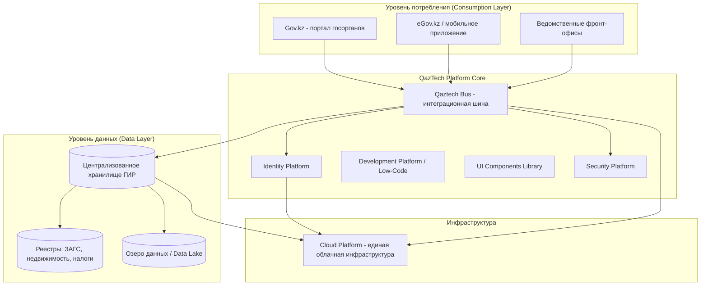
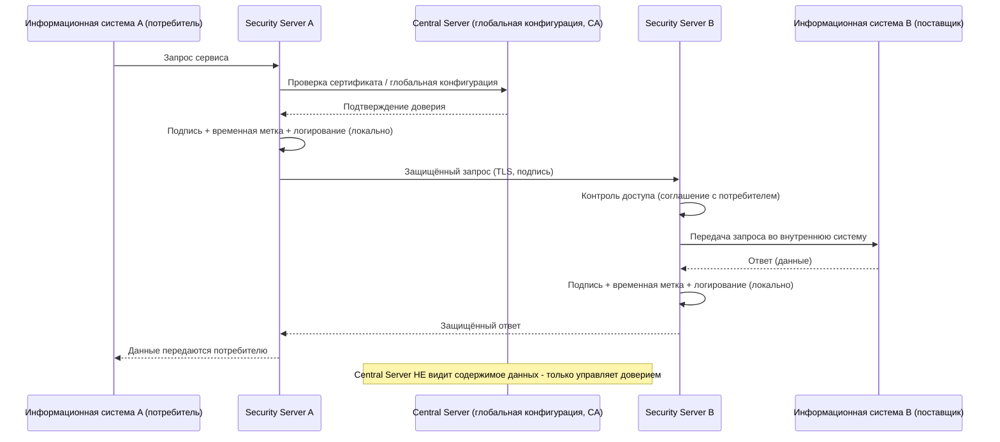
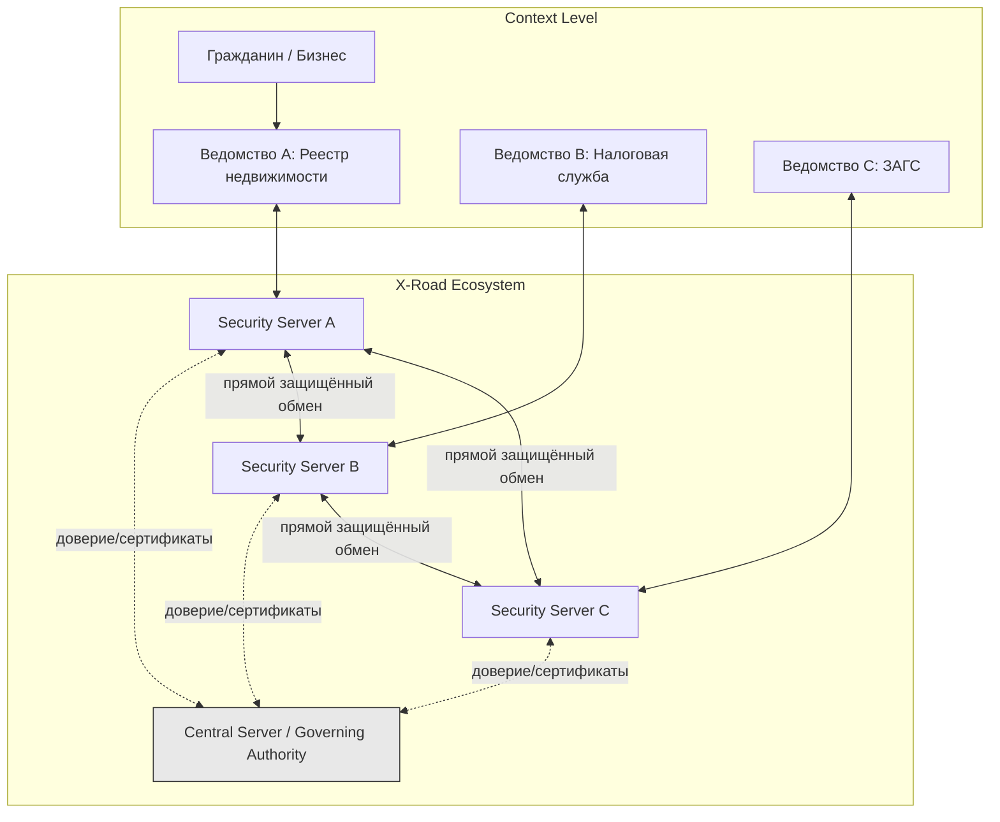
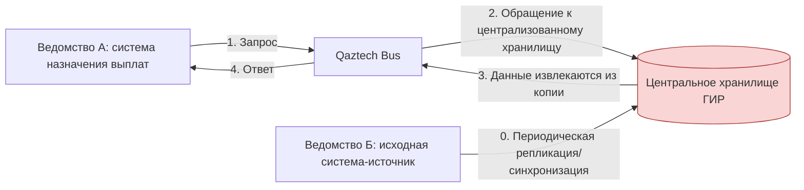
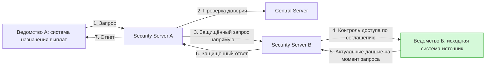
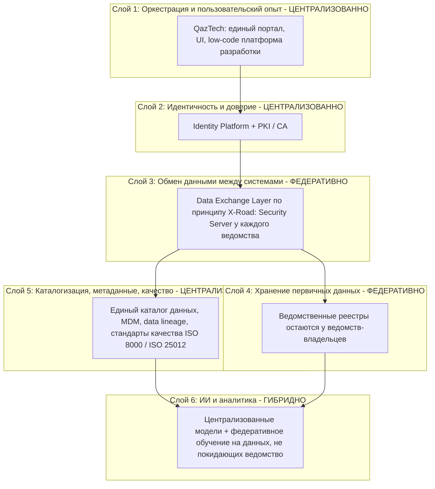

# Централизация (QazTech) vs федеративная модель (X-Road): какой путь выбирает Казахстан?

> 📘 Исследование из цикла **«Данные Казахстана глазами дата-инженера»** · [← ко всем материалам](README.md)

**Аналитический доклад в области архитектуры государственных данных, цифрового суверенитета и готовности к искусственному интеллекту**

*Формат: исследовательская публикация уровня policy paper (OECD / World Bank / Gartner style)*
*Дата подготовки: июль 2026 г.*
*Методология: анализ официальных источников (законодательство РК, документация X-Road, отчёты OECD, World Bank, UN DESA, стандарты ISO, EU AI Act, NIST AI RMF); открытые данные Министерства цифрового развития РК и АО «Национальные информационные технологии»*

> **Примечание о достоверности.** Настоящий доклад различает три типа утверждений: (1) **подтверждённые факты** - со ссылкой на официальный источник; (2) **экспертные оценки** - консенсусные позиции индустрии и научного сообщества (Gartner, IDC, академические публикации), которые могут не иметь единственного канонического источника; (3) **авторские выводы** - аналитические суждения авторов доклада, логически выведенные из фактов 1 и 2, но не являющиеся официальной позицией какого-либо органа. Там, где официальной информации о QazTech недостаточно (архитектура находится в стадии опытной эксплуатации по состоянию на 2025-2026 гг.), это указано явно.

---

## Оглавление

1. [Executive Summary](#executive-summary)
2. [Введение: почему архитектура данных решает судьбу цифрового государства](#введение)
3. [Централизованная модель: QazTech](#централизованная-модель)
4. [Федеративная архитектура: X-Road](#федеративная-архитектура)
5. [Архитектурное сравнение: 32 критерия](#архитектурное-сравнение)
6. [Что лучше для искусственного интеллекта](#что-лучше-для-ai)
7. [Кейс Казахстана: текущее состояние](#кейс-казахстана)
8. [Какая архитектура подходит Казахстану: гибридная модель](#гибридная-модель)
9. [Практические рекомендации: дорожная карта на 5/10/15 лет](#дорожная-карта)
10. [Key Findings](#key-findings)
11. [Lessons Learned](#lessons-learned)
12. [Заключение](#заключение)
13. [Источники (APA 7)](#источники)

---

## 1. Executive Summary

Казахстан находится в точке архитектурного выбора, сопоставимого по значимости с решениями, которые в начале 2000-х принимала Эстония, а в 2010-х - Индия, Сингапур и страны ЕС. С января 2026 года правительство ввело мораторий на создание государственных информационных систем вне единой платформы **QazTech** и обязало государственные органы и организации квазигосударственного сектора завершить миграцию на неё (Inform.kz, 2026; Ustinka Live, 2026). Это решение - де-факто выбор в пользу **централизованной архитектуры** государственных цифровых сервисов, реализуемой АО «Национальные информационные технологии» под управлением Министерства искусственного интеллекта и цифрового развития РК (NITEC, 2025).

Одновременно исторический опыт межведомственного обмена данными в Казахстане (шлюз «электронного правительства») развивался в логике, близкой к **федеративной модели обмена данными**, эталоном которой в мире остаётся эстонский **X-Road** - распределённый, но централизованно управляемый слой обмена данными, действующий с 2001 года и лежащий в основе интероперабельности государственных систем Эстонии, Финляндии, Исландии и более 20 стран мира (e-Estonia, 2025; X-Road Foundation, 2025; NIIS/GitHub, 2025).

Доклад показывает, что выбор архитектуры данных - это не техническое, а **стратегическое решение**, определяющее:

- скорость и качество построения национальных возможностей в области искусственного интеллекта (data readiness for AI);
- степень технологического суверенитета и зависимости от вендоров;
- устойчивость государственных цифровых сервисов к сбоям и киберугрозам;
- соответствие международным рамкам регулирования данных (EU AI Act, Data Governance Act, NIST AI RMF, ISO/IEC 38505, DAMA-DMBOK).

Казахстан по итогам UN E-Government Survey 2024 занимает **24-е место из 193 стран** с индексом EGDI 0,9009, входит в группу «очень высокого» уровня развития электронного правительства и лидирует среди стран СНГ и стран без выхода к морю (UN DESA, 2024; Egov.kz, 2024). Это создаёт солидную базу для перехода к следующему этапу - построению data-driven и AI-ready государства. Однако сам факт высокого места в рейтинге фронт-офисных сервисов не означает автоматической готовности данных к промышленному использованию ИИ: для этого требуется зрелая архитектура управления данными (data governance), а не только удобный портал.

Ключевой вывод доклада: **чистая централизация и чистая федерация - это не взаимоисключающие, а взаимодополняющие архитектурные слои**. Ни одна страна мира не построила устойчивую цифровую государственность на «чистой» модели. Эстония сочетает единый слой X-Road с децентрализованным хранением данных в ведомственных регистрах (принцип «no central database») (RIA, 2026; e-Estonia, 2025). Индия сочетает централизованные реестры идентичности (Aadhaar) с федеративным протоколом обмена (India Stack / DEPA). Практический вопрос для Казахстана - не «QazTech или X-Road», а **какие слои архитектуры должны быть централизованы (identity, security, orchestration), а какие - федеративны (хранение первичных данных, ведомственная ответственность, обмен через контракты данных)**.

---

## 2. Введение: почему архитектура данных решает судьбу цифрового государства

### 2.1. Данные как стратегический актив государства

Государственные данные - рождения, смерти, собственность, налоги, здравоохранение, образование, миграция, транспорт - образуют инфраструктурный слой, на котором строится вся остальная цифровая экономика. Всемирный банк определяет **цифровую публичную инфраструктуру (Digital Public Infrastructure, DPI)** как «фундаментальные цифровые строительные блоки, спроектированные для общественного блага»: цифровую идентичность, платежи и обмен данными, которые могут повторно использоваться в разных секторах экономики (World Bank, 2025a; World Bank, 2025b). Именно эти три компонента - идентичность, платежи, обмен данными - определяют, насколько быстро страна сможет масштабировать государственные услуги, финансовую инклюзию и - в горизонте следующего десятилетия - национальные системы искусственного интеллекта.

Организация экономического сотрудничества и развития (OECD) в своей Digital Government Policy Framework выделяет шесть измерений зрелого цифрового правительства, включая «government as a platform» (правительство как платформа) и управление данными как ключевые условия (OECD, 2020). Иными словами, международный консенсус состоит в том, что архитектура обмена данными - не второстепенный технический вопрос ИТ-департамента, а фактор национальной конкурентоспособности.

### 2.2. Почему это не просто «эффективность», а вопрос суверенитета

Централизация государственных данных в единой платформе несёт очевидные выгоды масштаба - но она же создаёт единую точку отказа (single point of failure), единую точку компрометации в случае кибератаки и потенциальную зависимость от конкретного вендора, оператора инфраструктуры или облачного провайдера. Федеративная архитектура, напротив, распределяет риск и ответственность между ведомствами-владельцами данных, но требует значительно более зрелого управления (governance), стандартизации и координации.

Технологический суверенитет в этом контексте - это не про отказ от иностранных технологий (X-Road, например, разработан Эстонией и Финляндией и распространяется как открытый исходный код через Nordic Institute for Interoperability Solutions, NIIS, под лицензией MIT - GitHub/NIIS, 2025), а про **контроль над архитектурными решениями, ключами шифрования, аудитом и возможностью независимой верификации того, кто, когда и зачем обращался к данным гражданина**.

### 2.3. Почему архитектура данных определяет будущее ИИ

Современные большие языковые модели и системы генеративного ИИ (LLM) не создают знания из воздуха - они обучаются и работают поверх данных, и качество их выводов напрямую зависит от качества, структурированности и происхождения (lineage) этих данных. NIST AI Risk Management Framework прямо связывает управляемость и надёжность ИИ-систем с управлением данными на всех этапах их жизненного цикла (NIST, 2023). Аналогичным образом, Data Governance Act ЕС (Регламент (ЕС) 2022/868) создаёт правовые механизмы для безопасного повторного использования государственных данных и посреднических услуг по обмену данными как инфраструктурного условия для инновационной, в том числе ИИ-ориентированной, экономики (European Commission, 2022).

Таким образом, вопрос «какую архитектуру выбрать» - это фактически вопрос «на каком фундаменте Казахстан будет строить национальный ИИ-стек в следующие 10-15 лет».

### 2.4. Три волны цифровизации государства и место архитектурного выбора в этой эволюции

Полезно рассматривать решение Казахстана в контексте трёх исторических волн цифровизации государственного управления, которые в разное время прошли ведущие страны:

**Волна 1 - «Цифровизация фронт-офиса» (Front-Office Digitization).** Государство переводит существующие бумажные процедуры в электронный вид - появляются порталы госуслуг, электронные заявления, онлайн-оплата. Казахстан прошёл эту волну успешно: высокое место в Online Service Index (10-е место в мире по UN E-Government Survey 2024 - Egov.kz, 2024) - прямое доказательство зрелости именно этого слоя.

**Волна 2 - «Интероперабельность бэк-офиса» (Back-Office Interoperability).** Государство переходит от изолированных ведомственных систем к архитектуре обмена данными, устраняя необходимость для гражданина повторно предоставлять одни и те же сведения разным ведомствам (принцип «once-only», реализованный, например, в X-Road - e-Estonia, 2025). Именно на этом этапе находится сегодня Казахстан: решения января 2026 года о единой платформе QazTech и мораторий на альтернативные системы (Inform.kz, 2026) - это архитектурный ответ именно на задачи второй волны.

**Волна 3 - «Государство, управляемое данными и ИИ» (Data- and AI-Driven Government).** Государство переходит от простого обмена данными к их систематическому использованию для прогнозирования, персонализации услуг, автоматизированного принятия решений и работы генеративных ИИ-ассистентов поверх государственных данных. Эта волна предъявляет принципиально иные требования к архитектуре - не только «может ли система А передать данные системе Б», но и «может ли модель ИИ объяснить, откуда взята каждая единица данных, использованная в её решении, и с какой степенью достоверности». Именно к этой волне относится содержание разделов 6 и 8 настоящего доклада.

Важно подчеркнуть: успешное прохождение Волны 2 является **необходимым, но не достаточным** условием для Волны 3. Страна может построить технически надёжный слой обмена данными и при этом не иметь зрелой дисциплины управления данными (data governance), которая нужна для промышленного, а не пилотного использования ИИ. Это ключевой аналитический тезис, который будет развит в разделе 6.

### 2.5. Аналогия из мира корпоративной архитектуры и индустриальная экспертная оценка

В корпоративном секторе дискуссия «централизация vs федерация» данных велась на протяжении последних 15 лет в контексте перехода от монолитных корпоративных хранилищ данных (Enterprise Data Warehouse) к доменно-ориентированным, федеративным архитектурам (data mesh, data fabric). Индустриальный консенсус аналитических компаний (в частности, Gartner и IDC), формировавшийся во второй половине 2010-х - начале 2020-х годов, состоит в следующем экспертном наблюдении: организации, которые пытались реализовать **единое централизованное хранилище всех данных предприятия**, систематически сталкивались с проблемой «бутылочного горлышка» - центральная команда данных физически не успевала обрабатывать запросы на подключение новых источников и обеспечивать актуальность данных для десятков бизнес-доменов одновременно. Это наблюдение - по своей сути аналогичное архитектурному риску, описанному в разделе 3.5 применительно к государственным платформам, - стало одним из аргументов в пользу доменно-ориентированных, федеративных архитектур данных в корпоративном мире. Государственный сектор, стоящий перед аналогичным выбором на порядок большего масштаба (десятки министерств вместо десятков бизнес-подразделений), сталкивается с той же архитектурной дилеммой, но в условиях значительно более высоких требований к безопасности, аудируемости и юридической значимости данных.

> **Экспертная оценка (не единственный источник, консенсус индустрии).** Данный тезис отражает широко распространённую в индустрии аналитики данных позицию, а не дословную цитату конкретного отчёта Gartner или IDC, доступ к которым не подтверждён прямым источником в рамках подготовки настоящего доклада; он приведён как контекстная рамка для понимания архитектурного выбора, а не как ссылка на конкретную публикацию.

---

## 3. Централизованная модель: QazTech

### 3.1. Что такое QazTech - подтверждённые факты

QazTech (ранее известна под рабочим названием «ГосТех») - национальная информационно-коммуникационная платформа электронного правительства Казахстана, разрабатываемая АО «Национальные информационные технологии» (НИТ) под управлением Министерства искусственного интеллекта и цифрового развития РК (NITEC, 2025). По заявлению министра Жаслана Мадиева, платформа предназначена для автоматизации деятельности государственных органов, включая автоматизацию государственных функций и оказание вытекающих из них услуг, а также **централизованного сбора, обработки и хранения государственных электронных информационных ресурсов** (Uralsk Week, 2025).

По официальным данным на середину 2025 года, платформа находилась в опытной эксплуатации: на неё в пилотном режиме была мигрирована лишь часть действующих информационных систем, и в качестве одного из первых сервисов создана единая платформа интернет-ресурсов государственных органов Gov.kz (Uralsk Week, 2025).

3 января 2026 года на совещании правительства под председательством заместителя премьер-министра - министра искусственного интеллекта и цифрового развития Жаслана Мадиева были приняты решения, кардинально меняющие статус QazTech:

- **обязательный переход** всех государственных органов и организаций квазигосударственного сектора на платформу QazTech (Inform.kz, 2026; Ustinka Live, 2026);
- **мораторий с начала 2026 года** на разработку новых информационных систем вне платформы QazTech (Tadviser, 2026);
- установлен срок завершения миграции ведомственных информационных систем - **до 30 сентября** (год не уточнён в источнике; требует официального подтверждения) (Inform.kz, 2026);
- в случаях, когда разработка нового объекта информатизации на платформе QazTech невозможна, каждый такой случай должен выноситься на рассмотрение **Комиссии при президенте по вопросам внедрения цифровизации в Республике Казахстан** (Tadviser, 2026).

Официальная формулировка цели, приводимая министром: «выстроить устойчивую, единую и эффективную цифровую платформу государства, где цифровые решения работают как система, а не как разрозненные проекты» (Inform.kz, 2026). 2026 год объявлен в Казахстане Годом цифровизации и искусственного интеллекта (Inform.kz, 2026).

### 3.2. Технологическая архитектура - что известно официально

Согласно материалам АО «Национальные информационные технологии», технологически платформа QazTech состоит из шести модулей (NITEC, 2025):

1. **Cloud platform** - облачная платформа (вычислительная и инфраструктурная база);
2. **Development platform** - платформа разработки (низкокодовые/no-code инструменты и среда для создания государственных сервисов);
3. **Qaztech UI components** - библиотека компонентов пользовательского интерфейса;
4. **Identity platform** - платформа идентификации;
5. **Qaztech bus** - интеграционная шина;
6. **Security platform** - платформа безопасности.

> **Ограничение достоверности.** Публично доступные официальные документы (по состоянию на момент подготовки доклада) не раскрывают детальную техническую архитектуру на уровне протоколов обмена, модели данных, схемы шифрования, механизма аудита или SLA доступности. Ниже приводится **аналитическая, а не официально подтверждённая** реконструкция типовой архитектуры государственной платформы такого класса, основанная на общей логике аналогичных национальных «GovTech»-платформ (в частности, российского «Гостеха», на который прямо ссылается источник как на аналог - Tadviser, 2026) и общепринятой архитектуре enterprise-платформ по TOGAF.

### 3.3. Типовая архитектура централизованной GovTech-платформы (аналитическая реконструкция)

**Ключевая архитектурная особенность централизованной модели**: интеграционная шина (bus), идентификация, безопасность и хранение данных находятся под управлением **одного оператора платформы**, а не распределены между ведомствами-владельцами данных. Это принципиально отличает модель от X-Road, где, как показано в разделе 4, данные физически остаются в ведомственных системах.

### 3.4. Преимущества централизованной модели

1. **Единая точка стандартизации.** Мораторий на разработку систем вне QazTech (Tadviser, 2026) исключает дублирование функциональности и несовместимые технологические стеки - проблему, которую OECD прямо называет барьером цифровой трансформации в Казахстане: до принятия единой платформенной модели цифровизация Казахстана характеризовалась «разрозненными проектами» (Inform.kz, 2026, со ссылкой на формулировку министра Мадиева).
2. **Экономия за счёт масштаба.** Единая облачная инфраструктура и единая платформа разработки снижают затраты на дублирующие сервера, лицензии и интеграционные проекты - это прямо декларируемая цель: «развитие цифровизации будет осуществляться в рамках единой архитектуры без дублирования функций и неэффективных бюджетных расходов» (Inform.kz, 2026).
3. **Скорость внедрения новых сервисов.** Единая платформа разработки (low-code) и готовая библиотека UI-компонентов теоретически позволяют выводить новые государственные услуги быстрее, чем при независимой разработке каждым ведомством.
4. **Централизованное управление кибербезопасностью.** Security Platform как единый модуль облегчает применение единых политик безопасности, патч-менеджмент и мониторинг инцидентов в масштабе всего государства - что соответствует логике ISO/IEC 27001 (система менеджмента информационной безопасности), если она последовательно применяется к единой платформе (ISO/IEC, 2022).
5. **Единая точка ответственности перед гражданином.** С точки зрения пользователя, единая платформа снижает когнитивную нагрузку - один портал, один аккаунт, единый пользовательский опыт.

### 3.5. Риски и ограничения централизованной модели

1. **Единая точка отказа (Single Point of Failure).** Авария, программная ошибка или целенаправленная атака на ядро платформы потенциально парализует все государственные сервисы одновременно - в отличие от федеративной модели, где сбой одного ведомственного регистра не блокирует остальные.
2. **Концентрированная поверхность кибератаки.** Централизация данных большого числа ведомств в едином хранилище увеличивает ценность цели для злоумышленников и государств-агрессоров, что прямо противоречит логике «Zero Trust» и принципу минимизации привилегий, заложенному, например, в директиве NIS2 ЕС (обязывающей операторов существенных услуг применять риск-ориентированный, а не монолитный подход к киберзащите) (European Parliament and Council, 2022).
3. **Риск vendor lock-in.** Зависимость от единого технологического стека платформы (даже если она разрабатывается государственной компанией НИТ) создаёт архитектурную зависимость, которую сложно обратить: миграция с централизованной платформы обходится на порядок дороже, чем миграция одного ведомственного сервиса.
4. **Governance-риск концентрации данных.** Централизованное хранилище государственных электронных информационных ресурсов создаёт вопросы о разграничении прав доступа между ведомствами, целевом использовании данных и защите от избыточного доступа (data minimization) - принцип, закреплённый в Data Governance Act ЕС как условие безопасного повторного использования государственных данных (European Commission, 2022).
5. **Сложность демонстрации подотчётности (accountability).** В отличие от X-Road, где, как показано ниже, каждая транзакция обмена данными юридически значимо логируется на стороне обеих участвующих организаций (RIA, 2026), в единой централизованной платформе требуется отдельно спроектированный и технически надёжный механизм аудита, который не должен зависеть от оператора той же платформы, чьи действия он призван контролировать.
6. **Институциональный риск.** Мораторий на создание систем вне QazTech и обязательный перенос всех проектов, для которых это невозможно, на рассмотрение президентской комиссии (Tadviser, 2026) - это сильное административное решение, которое ускоряет консолидацию, но одновременно повышает нагрузку на единый орган принятия решений и снижает гибкость ведомств в реагировании на специфические задачи их сектора.

> **Авторский вывод.** Прямое сравнение официальных формулировок («ГосТех», единая платформа, мораторий) с международной практикой показывает, что Казахстан реализует классическую **платформенную (platform-as-government) модель**, близкую к российскому «Гостеху» (на это прямо указывает источник Tadviser, 2026) и отчасти к индийскому India Stack на уровне идентичности, но принципиально отличную от X-Road на уровне архитектуры хранения и обмена данными.

### 3.6. Операционная модель и вопрос ответственности

Отдельного анализа заслуживает вопрос операционной ответственности. В централизованной модели АО «Национальные информационные технологии» выступает одновременно оператором инфраструктуры, разработчиком платформы и - в силу модуля Identity Platform - фактическим держателем ключевого механизма аутентификации граждан в цифровом государстве (NITEC, 2025). Подобная концентрация ролей типична для платформенных GovTech-моделей и создаёт операционную эффективность (единая команда, единый бюджет, единая точка ответственности перед правительством), но одновременно поднимает классический вопрос корпоративного управления ИТ, сформулированный в стандарте ISO/IEC 38505 (Governance of data): кто выполняет роль независимого контролирующего органа по отношению к оператору, если оператор одновременно и строит платформу, и управляет данными на ней, и - потенциально - участвует в аудите собственной работы? Международная практика (например, институциональное разделение ролей оператора и надзорного органа в Эстонии, где RIA выполняет функции государственного надзора отдельно от технической эксплуатации - RIA, 2026) показывает, что этот вопрос требует явного институционального решения, а не оставляется на усмотрение оператора платформы.

Это не критика конкретной организационной модели QazTech - на момент подготовки доклада публично доступная информация не позволяет оценить, предусмотрен ли для платформы отдельный независимый надзорный орган помимо президентской комиссии по цифровизации (Tadviser, 2026), - а фиксация архитектурного вопроса, который целесообразно решить на раннем этапе развития платформы, пока стоимость институциональных изменений относительно невысока.

---

## 4. Федеративная архитектура: X-Road

### 4.1. Общая характеристика

X-Road определяется его разработчиками как «централизованно управляемый распределённый слой обмена данными между информационными системами» (X-Road Foundation / NIIS, 2025). Это определение важно понимать буквально: X-Road **не хранит данные**. Он не является ни базой данных, ни хранилищем, ни озером данных. Это протокольный и инфраструктурный слой, обеспечивающий стандартизированный, защищённый и юридически значимый обмен сообщениями между информационными системами, которые остаются в собственности и под управлением тех организаций, которые ими владеют (X-Road Foundation, 2025; e-Estonia, 2025).

X-Road был запущен Департаментом государственных информационных систем Эстонии в 2001 году; ключевую роль в разработке сыграла эстонская компания Cybernetica (Cyber.ee, 2025; X-Road Foundation, 2025). С 2015 по июнь 2018 года ядро платформы совместно развивали Эстония и Финляндия, после чего разработка была передана созданному ими совместному **Nordic Institute for Interoperability Solutions (NIIS)**, членами которого сегодня являются Эстония, Финляндия и Исландия, а партнёром - Фарерские острова (RIA, 2026). Исходный код центральных компонентов был открыт 3 октября 2016 года под лицензией MIT (Wikipedia/X-Road, со ссылкой на NIIS Yearbook 2017). Сегодня технология или её производные (UXP, PlanetCross, Roksnet) внедрены более чем в 20 странах мира (e-Estonia, 2025).

По данным Европейской комиссии (2018), уже в 2018 году X-Road связывал более 1000 взаимосвязанных баз данных, обеспечивающих около 1700 сервисов и обрабатывающих свыше 50 миллионов запросов в месяц (European Commission, 2018). По данным e-Governance Academy Эстонии, использование X-Road позволило Эстонии сэкономить 804 человеко-года рабочего времени в 2017 году и 1407 человеко-лет - в 2018 году (Cyber.ee, 2025).

### 4.2. Ключевые технические компоненты

#### 4.2.1. Security Server (Сервер безопасности)

Security Server - обязательная «точка входа» X-Road для каждой организации-участника, будь то поставщик или потребитель данных. Она выполняет функции (NIIS/GitHub, 2025; X-Road Foundation, 2025):

- посредничество в обмене запросами и ответами между информационной системой-потребителем и информационной системой-поставщиком;
- управление ключами подписи и аутентификации;
- отправку сообщений по защищённому каналу (HTTPS/TLS в обе стороны);
- создание доказательного значения (proof value) для сообщений посредством цифровой подписи;
- временны́е метки (time-stamping) и логирование.

Важно: Security Server **применяет контроль доступа** на стороне поставщика данных, гарантируя, что только те потребители, которые подписали соответствующее соглашение с поставщиком услуги, могут получить доступ к данным (X-Road Foundation, 2025).

#### 4.2.2. Central Server и Distributed Registry (глобальная конфигурация)

Идентичность каждой организации и каждой технической точки входа (Security Server) верифицируется сертификатами, выданными доверенным удостоверяющим центром (Certification Authority, CA) в момент присоединения организации к экосистеме X-Road (X-Road Foundation, 2025). При этом принципиально важная архитектурная особенность: **идентичности поддерживаются централизованно, но сами данные обмениваются напрямую между потребителем и поставщиком** (X-Road Foundation, 2025). Маршрутизация сообщений строится на основе идентификаторов уровня организации и сервиса, которые X-Road сопоставляет с физическими сетевыми адресами сервисов.

Это ключевое отличие от QazTech-подобной модели: **Central Server не хранит и не видит содержимое данных**, которые проходят через экосистему - он управляет только конфигурацией доверия (сертификаты, реестр участников, глобальные настройки).

#### 4.2.3. Data Exchange Layer

Data Exchange Layer (DXL) - это общее название класса технологий, к которому относится X-Road: стандартизированный, согласованный, совместный, интероперабельный и защищённый слой обмена данными, дающий поставщикам услуг принципиально новую возможность делать свои сервисы видимыми для граждан, бизнеса и других государственных служащих (NIIS/GitHub, 2025). Национальные версии подобного слоя также существуют под другими именами - например, эстонская версия сегодня официально называется X-tee (RIA, 2026).

#### 4.2.4. PKI и криптографическая инфраструктура

X-Road обеспечивает целостность и конфиденциальность передачи данных за счёт двунаправленного HTTP через TLS, цифровых подписей и шифрования сообщений, передаваемых через публичный интернет (X-Road Foundation, 2025). Каждое сообщение снабжается временно́й меткой и цифровой подписью, что делает возможной последующую верификацию содержимого сообщения - это техническая основа принципа неотказуемости (non-repudiation) (X-Road Foundation, 2025). Отдельные исследования также описывают применение технологии пакетного хеширования для эффективного подписания и временно́го маркирования больших объёмов сообщений (Ansper, Buldas, Freudenthal & Willemson, 2013, цит. по X-Road Foundation, 2025).

#### 4.2.5. Audit Logs и Message Integrity

Принципиальное архитектурное решение X-Road: **все свидетельства обмена данными (логи) хранятся локально сторонами обмена данными**, и ни одна третья сторона, включая оператора центральной инфраструктуры X-Road, не имеет доступа к содержимому данных (X-Road Foundation, 2025). Security Server логирует все сообщения, которые он обрабатывает, что вместе с временны́ми метками и цифровыми подписями позволяет впоследствии верифицировать содержимое сообщения (API Conference, 2025, со ссылкой на техническую документацию X-Road).

#### 4.2.6. Zero Trust как архитектурный принцип

Хотя термин «Zero Trust» не является собственной терминологией X-Road, архитектура фактически реализует его ключевые принципы: (1) ни один участник не доверяет каналу передачи данных по умолчанию - каждое сообщение аутентифицируется и подписывается отдельно; (2) контроль доступа применяется на уровне каждой отдельной организации-поставщика, а не на уровне периметра всей сети; (3) отсутствует единая точка, обладающая полным доступом ко всем данным системы. Это принципиально отличается от модели «доверенного периметра», характерной для многих централизованных государственных платформ.

### 4.3. Диаграмма взаимодействия X-Road (sequence diagram)

### 4.4. Архитектура на уровне C4 (Context)

Обратите внимание на принципиальное отличие от диаграммы QazTech в разделе 3.3: **данные не проходят через центральный узел** - Central Server управляет только доверием (trust management), а сами реестры (ведомства A, B, C) остаются владельцами и хранителями своих данных, реализуя принцип «no central database», принятый в Эстонии (e-Estonia, 2025).

### 4.5. Преимущества федеративной модели

1. **Отсутствие единой точки отказа.** Сбой в одном ведомственном регистре не парализует остальную систему.
2. **Локальная ответственность и подотчётность.** Каждое ведомство остаётся юридически ответственным за качество и защиту своих данных, что упрощает применение принципа «privacy by design» и распределяет комплаенс-нагрузку.
3. **Прозрачный, юридически значимый аудит по каждой транзакции**, хранящийся локально у обеих сторон обмена, без возможности единой точки скрытого доступа (X-Road Foundation, 2025).
4. **Принцип «once-only» («однократность ввода данных»)**: гражданин предоставляет данные только один раз, а системы повторно используют их через защищённый обмен, не дублируя хранение (e-Estonia, 2025).
5. **Простота горизонтального масштабирования и кросс-граничной федерации.** X-Road поддерживает встроенную федерацию - объединение двух экосистем X-Road, что и было реализовано между Эстонией и Финляндией в феврале 2018 года (e-Estonia, 2025).
6. **Открытый исходный код и отсутствие vendor lock-in на уровне ядра технологии** - распространяется под лицензией MIT (Wikipedia/X-Road со ссылкой на NIIS Yearbook 2017; GitHub/NIIS, 2025).

### 4.6. Исторический контекст: интероперабельность в Казахстане до QazTech

Важно подчеркнуть, что идея межведомственного обмена данными не является для Казахстана новой. Действовавший на протяжении многих лет портал «электронного правительства» eGov.kz, который правительство сейчас планирует заменить платформой QazTech (Uralsk Week, 2025), в течение десятилетия опирался на понятие «шлюза электронного правительства» - промежуточного технологического слоя, задача которого состояла именно в том, чтобы связывать между собой изначально разрозненные ведомственные информационные системы, не требуя их полной архитектурной унификации. Логика такого шлюза - с посреднической, а не консолидирующей ролью между системами - по своей архитектурной философии значительно ближе к принципам Data Exchange Layer (раздел 4.1), чем к принципам единого централизованного хранилища данных.

> **Ограничение достоверности.** Официальное подтверждение того, что казахстанский шлюз электронного правительства технически базировался на исходном коде или архитектурных решениях именно эстонского X-Road (в отличие от независимо разработанного отечественного решения со схожей функциональной ролью), не было обнаружено в источниках, использованных при подготовке настоящего доклада, и поэтому не утверждается как факт. Приведённое выше наблюдение ограничивается сопоставлением функциональной роли (посредническая интеграционная шина) и не является утверждением о происхождении конкретного программного кода.

Этот исторический факт важен по одной причине: переход к QazTech представляет собой не первый опыт Казахстана в области межведомственного обмена данными, а следующий, более амбициозный этап эволюции - от модели «шлюз связывает разрозненные системы» к модели «единая платформа заменяет разрозненные системы». Это принципиально иной архитектурный вектор, и понимание этого различия должно осознанно учитываться при проектировании новой платформы, чтобы не утратить преимущества уже накопленного опыта интеграции.

### 4.7. Риски и ограничения федеративной модели

1. **Высокие требования к governance-зрелости.** Федеративная модель требует значительно более сложной координации: единых стандартов метаданных, единых словарей данных, соглашений об уровне сервиса между десятками ведомств.
2. **Неоднородное качество данных у разных владельцев.** Поскольку данные остаются в ведомственных системах, качество, актуальность и полнота данных могут существенно различаться между ведомствами - при отсутствии единых правил качества данных (ISO/IEC 25012; ISO 8000) федерация рискует распределить, а не решить проблему «грязных данных».
3. **Более сложная модель совокупной кибербезопасности.** Хотя единой точки отказа нет, ландшафт защиты состоит из десятков независимо администрируемых Security Server, и совокупная защищённость экосистемы равна защищённости самого слабого её участника.
4. **Более высокая начальная стоимость и сложность внедрения** для стран без зрелой цифровой госслужбы: требуется одновременное развитие технических стандартов, институтов управления (governing authority) и цифровой культуры в десятках ведомств.
5. **Ограниченная централизованная видимость для аналитики и ИИ.** Поскольку данные физически не консолидируются, построение сквозной аналитики или обучение моделей ИИ на объединённых данных требует дополнительного слоя - витрин данных, каталогов, конвейеров ETL/ELT, которые в чисто федеративной модели не предусмотрены «из коробки».

---

## 5. Архитектурное сравнение: 32 критерия

### 5.0. Методологическая рамка сравнения

Прежде чем переходить к табличному сравнению, важно зафиксировать методологическую позицию: сравнение ниже проводится не между двумя конкретными продуктами (QazTech как программный продукт версии 2026 года и X-Road как программный продукт версии 7+), а между двумя **архитектурными парадигмами**, которые эти продукты представляют - **платформенной централизацией** и **федеративным обменом данными**. Это отличие принципиально, поскольку сама платформа QazTech технически способна в будущем реализовать элементы федеративной архитектуры внутри себя (см. раздел 8), а X-Road, в свою очередь, содержит централизованные компоненты (Central Server, PKI). Приведённая ниже таблица описывает архитектурные полюса, а не характеристики двух конкретных, статично зафиксированных технологических решений.

Каждый критерий оценивался по трём измерениям, типичным для enterprise-архитектурного анализа (TOGAF ADM, Phase E - Opportunities & Solutions): технической реализуемости, институциональной применимости в контексте государственного управления и соответствию международным стандартам, перечисленным во введении к докладу.

### 5.1. Сравнительная таблица

| № | Критерий | Централизованная модель (QazTech-тип) | Федеративная модель (X-Road-тип) |
|---|---|---|---|
| 1 | **Scalability (масштабируемость)** | Вертикальная, ограничена мощностью центральной платформы | Горизонтальная, органически растёт с числом участников |
| 2 | **Availability (доступность)** | Зависит от единого SLA платформы | Зависит от доступности каждого узла отдельно |
| 3 | **Fault tolerance (отказоустойчивость)** | Низкая при сбое ядра - риск каскадного отказа | Высокая - локальные сбои не распространяются |
| 4 | **Vendor lock-in** | Высокий риск при закрытой архитектуре платформы | Низкий - открытый исходный код ядра (MIT) |
| 5 | **Cybersecurity - площадь атаки** | Концентрированная, «единая мишень» | Распределённая, но множество точек входа |
| 6 | **Cybersecurity - управляемость политик** | Высокая (единая политика) | Требует координации политик между ведомствами |
| 7 | **Latency (задержка)** | Может расти при высокой централизованной нагрузке | Прямой обмен точка-точка, обычно ниже |
| 8 | **Interoperability (интероперабельность)** | Внутри платформы - высокая; вовне - зависит от API | Изначально спроектирована для интероперабельности |
| 9 | **AI readiness (готовность к ИИ)** | Высокая для консолидированной аналитики, если данные структурированы | Требует дополнительного слоя каталогизации и агрегации |
| 10 | **Data Quality** | Единые стандарты легче внедрить централизованно | Зависит от зрелости каждого ведомства |
| 11 | **Data Ownership (владение данными)** | Размыто между оператором платформы и ведомством | Чётко закреплено за ведомством-источником |
| 12 | **Compliance (регуляторное соответствие)** | Проще для единого аудита, сложнее для privacy-by-design на уровне источника | Проще для privacy-by-design, сложнее для единого аудита |
| 13 | **Governance (управление)** | Централизованное, единый орган принятия решений | Распределённое, требует governing authority + консорциум |
| 14 | **Identity Management** | Единая Identity Platform | Централизованный PKI/CA + локальная аутентификация |
| 15 | **Monitoring (мониторинг)** | Единая система мониторинга всей платформы | Мониторинг на уровне каждого Security Server |
| 16 | **Audit (аудит)** | Требует отдельного независимого механизма | Встроен «по умолчанию»: локальные логи с двух сторон |
| 17 | **Metadata Management** | Легче стандартизировать в едином каталоге | Требует федеративного каталога метаданных |
| 18 | **Master Data Management** | Централизованное MDM возможно «из коробки» | Требует соглашений о «золотой записи» между ведомствами |
| 19 | **API Management** | Единый API-шлюз (bus) | API-контракты на уровне каждого Security Server |
| 20 | **Cloud readiness** | Высокая - единая облачная платформа заложена архитектурно | Облачно-агностична - каждый узел выбирает своё окружение |
| 21 | **Cost - CAPEX** | Высокий первоначальный CAPEX на единую платформу | Ниже - инвестиции распределены по времени и ведомствам |
| 22 | **Cost - OPEX** | Потенциально ниже за счёт масштаба | Выше из-за необходимости поддержки множества узлов |
| 23 | **Operational complexity** | Ниже для конечного пользователя, выше для оператора платформы | Выше для координации, ниже для отдельного ведомства |
| 24 | **Time-to-market новых сервисов** | Быстрее при готовой low-code платформе | Медленнее - каждое ведомство разрабатывает самостоятельно |
| 25 | **Resilience to political/institutional risk** | Высокая зависимость от единого органа управления | Более устойчива к смене отдельных институтов |
| 26 | **Cross-border interoperability** | Требует отдельного шлюза для международного обмена | Встроенная поддержка федерации экосистем (пример: Эстония-Финляндия, 2018) |
| 27 | **Data localization compliance** | Проще обеспечить (данные физически в одном месте) | Сложнее без единого технического контроля локации |
| 28 | **Digital sovereignty** | Зависит от контроля над платформой (кто владеет кодом и инфраструктурой) | Зависит от контроля над каждым узлом отдельно |
| 29 | **Explainability / прослеживаемость решений** | Требует встроенного data lineage поверх платформы | Естественна на уровне транзакций, сложнее на уровне агрегатов |
| 30 | **Учёт legacy-систем ведомств** | Требует миграции/замены legacy-систем | Может интегрировать legacy-системы через Security Server без миграции |
| 31 | **Скорость внедрения в масштабах всей страны** | Потенциально быстрее при сильной политической воле (пример: мораторий 2026 г.) | Медленнее - требует поэтапного подключения каждого ведомства |
| 32 | **Институциональная зрелость, необходимая для успеха** | Средняя - достаточно сильного центрального органа | Высокая - требует зрелой культуры межведомственного сотрудничества |

### 5.2. Матрица зрелости (Capability Maturity Matrix)

| Уровень | Централизованная модель | Федеративная модель |
|---|---|---|
| **1. Initial** | Разрозненные ведомственные системы, отсутствие единых стандартов | Точечные двусторонние интеграции без общего протокола |
| **2. Managed** | Единая платформа в пилотной эксплуатации (текущий статус QazTech, 2025) | Пилотный Data Exchange Layer с 2-3 ведомствами |
| **3. Defined** | Обязательный переход всех ведомств, мораторий на альтернативы (текущий статус QazTech, 2026) | Security Server развёрнут у большинства ведомств, единый Central Server |
| **4. Quantitatively Managed** | SLA, метрики доступности, независимый аудит платформы | Федеративный каталог метаданных, единые data quality rules |
| **5. Optimizing** | ИИ-driven оркестрация сервисов, предиктивный мониторинг | Кросс-граничная федерация экосистем, автоматизированные data contracts |

### 5.3. SWOT-анализ

**Централизованная модель (QazTech)**

| Strengths | Weaknesses |
|---|---|
| Единая архитектура, устранение дублирования (Inform.kz, 2026) | Единая точка отказа |
| Сильная административная воля (мораторий, президентская комиссия) | Высокая зависимость от одного оператора (АО «НИТ») |
| Экономия на масштабе | Governance-риски концентрации данных |

| Opportunities | Threats |
|---|---|
| Быстрое масштабирование ИИ-сервисов на консолидированных данных | Концентрированная киберугроза национального масштаба |
| Единая инфраструктура для генеративного ИИ и госсервисов | Институциональная негибкость при жёстком моратории |

**Федеративная модель (X-Road-тип)**

| Strengths | Weaknesses |
|---|---|
| Открытый код, отсутствие vendor lock-in (MIT license) | Более медленное развёртывание в масштабе всей страны |
| Встроенный юридически значимый аудит | Требует высокой институциональной зрелости |
| Отказоустойчивость и локальная ответственность | Неравномерное качество данных между ведомствами |

| Opportunities | Threats |
|---|---|
| Международная интероперабельность (пример Эстония-Финляндия) | Риск фрагментации без сильного governing authority |
| Совместимость с открытыми ИИ-экосистемами и DPI-стандартами | Более сложная координация в условиях слабой межведомственной культуры |

### 5.4. PESTLE-анализ выбора архитектуры для Казахстана

| Фактор | Наблюдение |
|---|---|
| **Political** | Сильная централизация политической воли: правительственные решения января 2026 г. вводят обязательный переход и мораторий (Ustinka Live, 2026) |
| **Economic** | Цель - сокращение бюджетных расходов за счёт устранения дублирующих систем (Inform.kz, 2026) |
| **Social** | Казахстан уже входит в топ-10 по индексу онлайн-сервисов (Online Service Index) UN E-Government Survey 2024, что говорит о высоком уровне цифровой готовности населения (Egov.kz, 2024) |
| **Technological** | Одновременное развитие ИИ-повестки - 2026 год объявлен Годом цифровизации и ИИ (Inform.kz, 2026) |
| **Legal** | Принят Цифровой кодекс РК, регулирующий цифровые данные, платформы обмена данными и «цифровое правительство» (Adilet.zan.kz, 2026; Tadviser, 2026) |
| **Environmental** | Централизация облачной инфраструктуры потенциально снижает энергопотребление за счёт консолидации ЦОД (авторская оценка, не подтверждена официальным источником) |

### 5.5. RACI-матрица для гибридной архитектуры (авторское предложение)

| Функция | Уполномоченный орган в сфере цифровизации | АО «НИТ» / оператор QazTech | Ведомство-владелец данных | Президентская комиссия по цифровизации |
|---|---|---|---|---|
| Стандарты обмена данными (протоколы, схемы) | R/A | C | C | I |
| Хранение первичных ведомственных данных | I | C | R/A | I |
| Identity & PKI | A | R | C | I |
| Мониторинг доступности платформы | C | R/A | I | I |
| Аудит доступа к персональным данным | A | R | R | I |
| Разрешение исключений из моратория QazTech | C | I | R | A |
| Каталог метаданных / Data Catalog | R/A | R | C | I |
| ИИ-модели на основе государственных данных | A | R | C | I |

*R - Responsible, A - Accountable, C - Consulted, I - Informed*

### 5.6. Risk Matrix

| Риск | Вероятность | Влияние | Модель, где риск выше |
|---|---|---|---|
| Каскадный отказ инфраструктуры | Средняя | Критическое | Централизованная |
| Утечка персональных данных через единую точку | Средняя | Критическое | Централизованная |
| Фрагментация стандартов данных | Средняя | Высокое | Федеративная (при слабом governance) |
| Задержка вывода новых ИИ-сервисов | Низкая-средняя | Среднее | Федеративная (без единого каталога) |
| Vendor lock-in и потеря контроля над кодом | Средняя | Высокое | Централизованная (если платформа закрытая) |
| Несоответствие международным стандартам интероперабельности | Низкая | Среднее | Обе модели - зависит от следования ISO/GovStack стандартам |

### 5.7. Capability Map: функциональные возможности, которые обязана иметь любая из архитектур

Независимо от того, какая архитектурная парадигма выбрана, зрелая национальная инфраструктура данных должна закрывать следующую карту возможностей (Capability Map), сгруппированную по доменам:

| Домен возможностей | Конкретные возможности | Реализация в централизованной модели | Реализация в федеративной модели |
|---|---|---|---|
| **Управление доступом** | Аутентификация, авторизация, PKI | Identity Platform (единый модуль) | Central Server + локальный контроль доступа на Security Server |
| **Обмен данными** | Маршрутизация запросов, контракты данных | Qaztech bus (интеграционная шина) | Security Server + соглашения между ведомствами |
| **Наблюдаемость** | Мониторинг, алертинг, метрики SLA | Единая система мониторинга платформы | Мониторинг на уровне каждого узла + агрегация |
| **Аудит и комплаенс** | Логирование транзакций, неотказуемость | Требует отдельного модуля аудита | Встроенный локальный аудит на обеих сторонах транзакции |
| **Управление данными** | Каталог, метаданные, MDM, качество | Централизованный сервис каталогизации | Федеративный каталог с локальными источниками правды |
| **Разработка сервисов** | Low-code/no-code, переиспользуемые компоненты | Development Platform + UI Components | Каждое ведомство разрабатывает самостоятельно поверх общего протокола |
| **Кибербезопасность** | СМИБ, управление уязвимостями | Security Platform (единая политика) | Распределённая ответственность, единые минимальные требования |
| **ИИ и аналитика** | Обучение моделей, инференс, объяснимость | Централизованные вычислительные мощности | Федеративное обучение, локальный инференс на данных источника |

### 5.8. Синтез: что показывает сравнение по 32 критериям

Табличное сравнение (раздел 5.1) демонстрирует устойчивую закономерность: централизованная модель системно превосходит федеративную по критериям, связанным со **скоростью, простотой пользовательского опыта и экономией на масштабе** (критерии 7, 9 частично, 21 частично, 24, 31), тогда как федеративная модель системно превосходит централизованную по критериям, связанным с **отказоустойчивостью, распределением риска, подотчётностью и открытостью** (критерии 3, 4, 11, 16, 25, 26). Это не случайное распределение - оно отражает фундаментальный архитектурный компромисс между **консолидацией контроля** (быстрее, проще управлять, но более хрупко) и **распределением контроля** (медленнее, сложнее координировать, но устойчивее). Данный компромисс невозможно устранить выбором «лучшей» технологии - он может быть только сбалансирован через продуманное распределение архитектурных слоёв, что и является предметом раздела 8.

### 5.9. Data Flow: сравнение потока данных при типовом межведомственном запросе

Ниже - сравнение того, как физически перемещаются данные при выполнении одной и той же практической задачи («ведомство А запрашивает у ведомства Б данные для назначения социальной выплаты») в двух архитектурных парадигмах.

**Data Flow в централизованной модели (данные консолидируются в едином хранилище):**

*Особенность: данные ведомства Б физически реплицируются в центральное хранилище ещё до момента запроса (шаг 0), что создаёт временной разрыв между актуальностью данных у источника и данных в хранилище, а также требует отдельного механизма контроля версий и синхронизации.*

**Data Flow в федеративной модели (данные не покидают источник до момента запроса):**

*Особенность: данные передаются напрямую из источника в момент запроса («точно вовремя», just-in-time), без промежуточной копии, что гарантирует максимальную актуальность, но требует постоянной доступности системы-источника (ведомства Б) в момент запроса.*

**Аналитический вывод:** централизованная модель торгует актуальностью данных в обмен на доступность (даже если источник временно недоступен, копия в центральном хранилище отвечает на запрос); федеративная модель торгует доступностью в обмен на актуальность (данные всегда свежие, но при недоступности источника запрос не может быть выполнен). Выбор между этими компромиссами должен приниматься осознанно для каждого конкретного типа данных, а не единообразно для всей государственной архитектуры - что является ещё одним аргументом в пользу гибридной модели, рассматриваемой в разделе 8.

---

## 6. Что лучше для искусственного интеллекта

### 6.1. Почему ИИ не может работать на хаотичных данных

Фундаментальный тезис: **современные LLM и промышленные ИИ-системы не заменяют управление данными - они делают его критически необходимым**. Способность модели дать корректный, объяснимый и воспроизводимый ответ зависит от качества данных на входе (принцип "garbage in, garbage out"), а способность государства **доверять** решениям, принятым с участием ИИ, зависит от возможности проследить происхождение и путь трансформации данных (data lineage).

NIST AI RMF формулирует управление ИИ-рисками как непрерывный цикл из четырёх функций: **Govern, Map, Measure, Manage** - то есть управление данными и рисками должно быть встроено в жизненный цикл ИИ-системы, а не быть отдельной надстройкой (NIST, 2023; DPO Europe, 2025). Функция «Manage» прямо предполагает распределение ресурсов на риски, выявленные на этапах Map и Measure, включая планы реагирования на инциденты (DPO Europe, 2025).

EU AI Act (Регламент (ЕС) 2024/1689) вводит риск-ориентированную классификацию систем ИИ на четыре категории - от неприемлемого риска (запрещённые практики, например социальный скоринг) до систем с высоким, ограниченным и минимальным риском (European Commission, n.d., цит. по ecCouncil, 2026). Для систем **высокого риска** (кредитный скоринг, HR, критическая инфраструктура) закон требует строгих мер в отношении данных, управления и прозрачности, включая ведение детальной документации и обеспечение возможности регуляторного доступа для аудита (ZenGRC, 2025). Штрафы за нарушения могут достигать 35 млн евро или 7% глобального оборота компании для запрещённых практик (RiskPublishing, 2026).

### 6.1.1. Что конкретно ломается, когда государственный ИИ работает поверх хаотичных данных

Полезно перечислить конкретные, а не абстрактные последствия отсутствия зрелого управления данными для государственных ИИ-систем - это то, что архитекторы данных называют «долгом данных» (data debt), проявляющимся не сразу, а на этапе масштабирования пилота до промышленной эксплуатации:

- **Дублирующиеся и противоречащие друг другу записи об одном и том же гражданине или объекте** (отсутствие Master Data Management) приводят к тому, что модель ИИ либо произвольно выбирает одну из версий записи, либо усредняет противоречивые значения, создавая систематическую погрешность в решениях, затрагивающих реальных людей - например, при автоматизированном начислении социальных выплат.
- **Отсутствие метаданных о степени актуальности и достоверности данных** приводит к тому, что модель не может отличить свежую, верифицированную запись от устаревшей или неподтверждённой, и обрабатывает их с одинаковым «доверием».
- **Отсутствие единых классификаторов (reference data)** между ведомствами заставляет модель либо игнорировать часть данных из-за несовместимости форматов, либо тратить непропорционально много вычислительных ресурсов на нормализацию «на лету», что снижает надёжность и повышает стоимость эксплуатации.
- **Отсутствие data lineage** делает невозможным содержательный ответ на вопрос гражданина или регулятора «почему модель приняла именно такое решение в отношении меня» - ключевое требование объяснимости, закреплённое и в NIST AI RMF, и в EU AI Act применительно к системам высокого риска (ZenGRC, 2025; NIST, 2023).
- **Отсутствие data contracts** между ведомствами-источниками и ведомствами-потребителями данных приводит к «тихим» изменениям схемы данных (например, ведомство меняет формат поля без предупреждения), которые для традиционного ИТ-процесса являются раздражающим, но управляемым инцидентом, а для автоматизированного ИИ-конвейера могут привести к незаметному системному искажению результатов на протяжении месяцев до обнаружения.

Это перечисление не является гипотетическим - оно отражает задокументированный в мировой практике управления данными класс проблем, знакомый любой организации, пытавшейся масштабировать аналитику или ИИ поверх исторически разрозненных систем, независимо от отрасли (частный сектор, финансовые институты, государственное управление).

### 6.2. Компоненты data governance, необходимые для промышленного ИИ

Для того чтобы государственные данные были пригодны для обучения и эксплуатации ИИ-систем в производственном контуре (а не только для пилотных демонстраций), требуется зрелость по следующим компонентам:

1. **Data Governance (управление данными).** Формализованная система принятия решений о данных - кто владеет, кто может использовать, по каким правилам. Международный стандарт **ISO/IEC 38505** («Governance of data») расширяет принципы корпоративного управления ИТ (ISO/IEC 38500) на управление данными как активом, вводя модель принятия решений о данных на основе шести принципов (ответственность, стратегия, приобретение, производительность, соответствие, человеческое поведение).

2. **Metadata (метаданные).** Без структурированных метаданных - описаний происхождения, формата, владельца, чувствительности данных - ни одна ИИ-система не может автоматически определить, какие данные пригодны, актуальны и юридически доступны для конкретной задачи.

3. **Master Data Management (MDM).** Управление эталонными («золотыми») записями критично важных сущностей - гражданина, организации, объекта недвижимости - необходимо, чтобы ИИ-система не работала с противоречащими друг другу версиями одной и той же записи, распределёнными по разным ведомственным системам.

4. **Data Lineage (происхождение данных).** Способность проследить путь данных от первичного источника через все трансформации до конечного использования в модели ИИ - обязательное условие для объяснимости (explainability) и для комплаенса с EU AI Act в части документирования систем высокого риска (ZenGRC, 2025).

5. **Data Catalog (каталог данных).** Единый (или федеративный) реестр доступных наборов данных с описанием их структуры, качества и условий доступа - практический механизм реализации принципов Data Governance Act ЕС о посреднических услугах доступа к данным (European Commission, 2022).

6. **Reference Data (нормативно-справочная информация).** Стандартизированные классификаторы (коды регионов, отраслей, видов документов) необходимы для того, чтобы модели ИИ могли сопоставлять данные из разных источников без ручной нормализации.

7. **Quality Rules (правила качества данных).** Стандарт **ISO/IEC 25012** определяет модель качества данных по 15 характеристикам (точность, полнота, согласованность, актуальность, доступность и др.), применимую как основа для автоматизированных правил валидации данных перед их использованием в ИИ-конвейерах. Серия стандартов **ISO 8000** посвящена именно качеству данных и портируемости мастер-данных, включая обмен ими между организациями.

8. **Data Contracts (контракты данных).** Формальные, машиночитаемые соглашения между поставщиком и потребителем данных о структуре, семантике, SLA и правилах изменения схемы данных - практика, органично вытекающая из архитектуры X-Road, где Security Server поставщика применяет контроль доступа именно на основе подписанного соглашения с потребителем (X-Road Foundation, 2025), и являющаяся сегодня индустриальным стандартом для построения надёжных data pipeline для ИИ.

9. **Knowledge Graphs (графы знаний).** Для того чтобы LLM могли работать с государственными данными с высокой точностью (в том числе в подходах retrieval-augmented generation), данные должны быть не просто структурированы, но и связаны семантически - через графовые модели, отражающие реальные отношения между сущностями (гражданин - документ - услуга - ведомство).

10. **Explainability (объяснимость).** Требование прослеживаемости решений ИИ-систем прямо закреплено и в NIST AI RMF (функция Measure/Map), и в EU AI Act применительно к системам высокого риска (ZenGRC, 2025; NIST, 2023).

### 6.3. DAMA-DMBOK как рамка для государственного data governance

Свод знаний по управлению данными **DAMA-DMBOK** (Data Management Body of Knowledge), разработанный международной ассоциацией DAMA International, описывает 11 функциональных областей управления данными - от Data Governance и Data Architecture до Metadata Management, Data Quality, Master Data Management и Data Security. Для государства, переходящего к промышленному использованию ИИ, DAMA-DMBOK предлагает не архитектурный выбор (централизация/федерация), а **дисциплину**, которая должна быть реализована независимо от выбранной архитектуры: без неё как централизованная платформа (QazTech), так и федеративная сеть (X-Road-тип) будут производить данные низкого качества, непригодные для надёжного ИИ.

### 6.4. Централизация vs федерация: что лучше для ИИ на практике

| Задача ИИ | Преимущество централизации | Преимущество федерации |
|---|---|---|
| Обучение крупных моделей на объединённых государственных данных | Данные физически консолидированы - не требуется сложный ETL | - |
| Инференс в реальном времени с обращением к первичным (актуальным) данным ведомств | - | Данные всегда актуальны у источника, не требуют репликации |
| Соответствие требованиям локализации и суверенитета данных | Легче технически проконтролировать | Сложнее без единого технического слоя контроля |
| Объяснимость и аудит конкретного решения | Требует отдельного инструмента lineage | Естественна благодаря транзакционным логам X-Road |
| Масштабирование новых ИИ-сервисов на основе одного каталога данных | Быстрее при готовой платформе | Быстрее при зрелом федеративном каталоге метаданных |
| Защита от единой точки компрометации обучающих данных | Ниже | Выше |

**Ключевой аналитический вывод раздела**: ни централизация, ни федерация сами по себе не создают готовность к ИИ. Готовность к ИИ создаёт **дисциплина управления данными** (governance, metadata, quality, lineage, catalog), надстроенная поверх любой из архитектур. Однако федеративная модель органически ближе к принципам объяснимости и подотчётности, тогда как централизованная модель органически ближе к скорости масштабирования и простоте построения единого конвейера обучения моделей. Оптимальная для ИИ архитектура - это централизованный **слой оркестрации и каталогизации** поверх федеративного **слоя хранения и владения** данными - то есть именно гибридная модель, рассматриваемая в разделе 8.

---

## 7. Кейс Казахстана: текущее состояние

### 7.1. Позиция Казахстана в международных рейтингах

Согласно UN E-Government Survey 2024 (готовится раз в два года Департаментом по экономическим и социальным вопросам ООН, UN DESA), Казахстан занял **24-е место из 193 стран** с индексом развития электронного правительства (EGDI) 0,9009, поднявшись на 4 позиции по сравнению с предыдущим отчётом 2022 года, когда страна занимала 28-е место (UN DESA, 2024; Astana Times, 2024; Egov.kz, 2024). Казахстан входит в группу стран с «очень высоким» уровнем EGDI, опережая Уругвай (25-е место), Швейцарию (26-е), Турцию (27-е), Францию (34-е), Китай (35-е) и Канаду (47-е) (Astana Times, 2024).

Казахстан также занял **10-е место в мире по Индексу онлайн-сервисов (Online Service Index, OSI)** - рядом с лидерами мирового рейтинга, такими как Южная Корея, Дания и Эстония, опередив Китай, Германию и Австралию (Egov.kz, 2024). Страна лидирует среди государств СНГ, опережая Россию (43-е место), Армению (48-е), Узбекистан (63-е) и Азербайджан (74-е), а также занимает **1-е место среди стран, не имеющих выхода к морю** (landlocked countries, LLDC), с показателем EGDI 0,9009 (Egov.kz, 2024; Qazinform, 2024).

По данным официального пресс-релиза egov.kz, значительный прогресс отмечен в развитии цифровой инфраструктуры и внедрении таких технологий, как искусственный интеллект, блокчейн и интернет вещей, включая такие решения, как «E-Лицензия» и «Smart Data Ukimet» (Egov.kz, 2024).

### 7.2. Институциональный и нормативный контекст

В 2026 году был принят **Цифровой кодекс Республики Казахстан** (Adilet.zan.kz, 2026). Согласно официальному тексту, размещённому в информационно-правовой системе «Әділет», кодекс вводит понятие «платформа обмена и оборота продуктов цифровых данных» - цифровую платформу, обеспечивающую доступ к продуктам цифровых данных с установленными условиями их обмена и оборота (Adilet.zan.kz, 2026). Кодекс прямо предусматривает право государственных органов, государственных юридических лиц, субъектов квазигосударственного сектора и частного предпринимательства создавать такие платформы **при соблюдении единых требований** в сферах цифровизации и кибербезопасности, утверждённых уполномоченным органом по развитию экономики данных (Adilet.zan.kz, 2026).

Кодекс также закрепляет обязанность государственных органов, государственных юридических лиц и субъектов квазигосударственного сектора предоставлять доступ **оператору «цифрового правительства»** к цифровым данным и цифровым записям для проведения аналитики данных в соответствии с требованиями по управлению цифровыми данными (Base.spinform.ru, 2026, цит. текст Цифрового кодекса РК). Отдельно регулируется управление данными, содержащими государственную тайну, служебную или конфиденциальную информацию и персональные данные - с учётом требований, установленных отдельными законами (Base.spinform.ru, 2026).

По оценке аналитического портала TAdviser, Цифровой кодекс закрепляет единые принципы регулирования цифровой сферы и определяет виды цифровых объектов - данные, активы, программное обеспечение, системы и платформы, создавая правовую основу для «цифрового государственного управления», развития «цифрового правительства» и национальной цифровой архитектуры (TAdviser, 2026).

Отдельно кодекс регулирует рынок продуктов цифровых данных: разрешена легальная упаковка и продажа обезличенной аналитики, но запрещён оборот «сырых» и персональных данных, а также хранение продуктов данных за пределами Казахстана в случаях, где это ограничено законом (ст. 31, п. 9 Цифрового кодекса, согласно Zakon.kz, 2026). При этом сами персональные данные (идентификационные записи) не могут быть предметом гражданского оборота (Zakon.kz, 2026).

### 7.3. Институциональная реформа: от Министерства цифрового развития к Министерству ИИ

Показательно, что должность, ранее именовавшаяся «министр цифрового развития, инноваций и аэрокосмической промышленности», к январю 2026 года трансформировалась в «заместитель премьер-министра - министр искусственного интеллекта и цифрового развития» (Ustinka Live, 2026; Inform.kz, 2026). Это институциональное изменение - повышение статуса цифровой повестки до уровня вице-премьера и прямое включение ИИ в название профильного министерства - подтверждённый факт, отражающий стратегический приоритет ИИ-повестки в государственном управлении Казахстана.

По данным OECD (2025), Казахстан продолжает системную реформу государственного управления, включая цифровую трансформацию, при этом ответственность за административную реформу чётко закреплена, а достигнут заметный прогресс в инициативах цифрового правительства (OECD, 2025). Более ранний обзор OECD (2023) констатировал, что «Digital Kazakhstan Strategy» (программа, завершившаяся к моменту публикации обзора) была успешна в построении комплексной системы цифрового государственного управления и в создании правовых и регуляторных условий для цифровой трансформации экономики, при этом отмечались нерешённые инфраструктурные и регуляторные вызовы, ограничивающие эффективность усилий, а также неравномерный уровень готовности фирм и государственных ведомств к цифровизации (OECD, 2023). На смену «Digital Kazakhstan» с начала 2022 года пришла программа «Digital Era Lifestyle» (DigitEL) - третья пятилетняя программа цифровизации, ориентированная на качественный и безопасный интернет, использование ИКТ-бизнеса как рычага роста экономики и дальнейшую цифровизацию сектора услуг, с целевым показателем доли ИКТ в ВВП на уровне 5% (против 4% в 2020 году), причём свыше 70% программы предполагалось финансировать за счёт частных инвестиций (OECD, 2023). По данным IMD, приводимым в том же обзоре OECD, цифровая конкурентоспособность Казахстана улучшилась - с 38-го места в 2018 году до 32-го в 2021 году в рейтинге цифровой конкурентоспособности IMD (OECD, 2023).

### 7.3.1. Развитие национального регулирования ИИ

По данным Times of Central Asia (2025), в 2024 году в Казахстане был одобрен проект закона об искусственном интеллекте, а также создан отдельный Комитет по искусственному интеллекту для надзора за развитием этой сферы (Times of Central Asia, 2025). Это подтверждённый факт институционального развития, синхронизированного с глобальным трендом на формирование специализированных регуляторных органов в области ИИ (сопоставимо с ролью Европейского офиса по ИИ, вводимого EU AI Act - DPO Europe, 2025). Одновременно источник отмечает, что страна продолжает модернизацию платформы электронного правительства с планами перехода на третью версию eGov и что Казахстан экспортирует ИТ-услуги в 86 стран (Times of Central Asia, 2025).

> **Ограничение достоверности.** Детальное содержание казахстанского проекта закона об ИИ, его риск-классификация и соотношение с рамками NIST AI RMF или EU AI Act не были обнаружены в достаточной полноте в открытых источниках на момент подготовки доклада; данный доклад воздерживается от оценки конкретных положений этого законопроекта и ограничивается фиксацией самого факта его разработки.

### 7.4. Сильные стороны - академическая оценка

1. **Высокая позиция в международных индексах цифрового правительства** без необходимости интерпретации - прямое следствие подтверждённых данных UN DESA (2024).
2. **Наличие консолидированной правовой базы** - принятие единого Цифрового кодекса РК, регулирующего данные, платформы и цифровое правительство в одном нормативном акте, что снижает фрагментацию регулирования, характерную для многих стран, где нормы разбросаны по десяткам отдельных законов (Adilet.zan.kz, 2026; TAdviser, 2026).
3. **Сильная политическая воля к консолидации архитектуры** - решения января 2026 года (мораторий, обязательная миграция) демонстрируют способность государства принимать и проводить в жизнь сложные архитектурные решения в сжатые сроки (Inform.kz, 2026).
4. **Институциональное признание стратегической роли ИИ** - повышение профильного министерства до уровня вице-премьерства и объявление 2026 года Годом цифровизации и ИИ (Inform.kz, 2026).
5. **Опыт экспорта ИТ-услуг** - по данным Times of Central Asia (2025), Казахстан экспортирует ИТ-услуги в 86 стран, включая Россию, Ирландию, Мексику, США и Сингапур, что говорит о зрелости определённого сегмента национальной ИТ-индустрии (Times of Central Asia, 2025).

### 7.5. Структурные вызовы - академическая оценка (без критики государства, в духе policy-анализа)

1. **Ранняя стадия зрелости платформы QazTech.** По официальным данным на середину 2025 года, платформа находилась в опытной эксплуатации с миграцией лишь части систем (Uralsk Week, 2025) - типичный вызов для любой страны, реализующей платформенную трансформацию такого масштаба в сжатые сроки; переход от пилота к обязательной общенациональной миграции за период менее года представляет собой значительную управленческую и техническую нагрузку.
2. **Ограниченная публичная техническая документация.** В отличие от X-Road, чья архитектура полностью документирована и открыта (X-Road Foundation, 2025; NIIS/GitHub, 2025), детальная техническая архитектура QazTech на уровне протоколов, моделей данных и SLA не была обнаружена в открытых источниках на момент подготовки доклада - что затрудняет независимую верификацию заявленных характеристик безопасности и отказоустойчивости и является типичным вызовом «раннего этапа» подобных платформ, а не уникальной особенностью Казахстана.
3. **Неравномерная готовность ведомств.** OECD (2023) прямо указывает на «высоко вариативную абсорбционную способность фирм и государственных ведомств», создающую барьеры со стороны спроса для эффективности и инклюзивности программы цифровизации государства - вызов, актуальный и для платформенного перехода 2026 года.
4. **Необходимость параллельного развития data governance, а не только инфраструктуры.** Как показано в разделе 6, готовность к промышленному ИИ определяется не архитектурой хранения, а зрелостью управления метаданными, качеством данных и происхождением данных - направление, отдельная публичная стратегия по которому (аналог DAMA-DMBOK для госсектора) не была обнаружена в открытых источниках на момент подготовки доклада.
5. **Риск-баланс между скоростью консолидации и институциональной гибкостью.** Обязательный мораторий и передача исключений на рассмотрение президентской комиссии (Tadviser, 2026) - эффективный инструмент для ускоренной стандартизации, но в среднесрочной перспективе создаёт нагрузку на единый орган принятия решений, что является общим архитектурным риском любой сильно централизованной модели управления (см. раздел 3.5), а не специфической проблемой Казахстана.

> **Явное разделение фактов и оценок.** Пункты 7.4 и 7.5 данного раздела не являются позицией какого-либо государственного органа Казахстана или международной организации; это аналитическая интерпретация авторов доклада на основе фактов, перечисленных в разделах 7.1-7.3, изложенная в академическом, а не публицистическом стиле.

---

## 8. Какая архитектура подходит Казахстану: гибридная модель

### 8.1. Ложная дихотомия «или-или»

Ни одна из стран - лидеров цифрового государственного управления не построила инфраструктуру данных на «чистой» модели. Эстония, эталон федеративной архитектуры, тем не менее использует централизованные компоненты - единый Central Server X-Road, управляющий доверием (PKI) для всей экосистемы, и единую систему цифровой идентичности (RIA, 2026; X-Road Foundation, 2025). Индийский DPI-стек сочетает централизованную биометрическую идентификацию (Aadhaar) с федеративными протоколами обмена данными (India Stack). Мировой Банк в своём подходе к DPI прямо не противопоставляет централизацию и федерацию, а описывает DPI как совокупность трёх компонентов - цифровая идентичность, платежи и **обмен данными и интероперабельные рамки** («Data exchange & interoperable frameworks») (World Bank, 2025b) - то есть архитектурный вопрос ставится не как выбор одной модели, а как вопрос дизайна каждого компонента.

### 8.2. Принцип многослойной архитектуры (layered architecture)

Ключевая рекомендация доклада: рассматривать государственную цифровую архитектуру не как единый монолитный выбор, а как **стек слоёв**, каждый из которых может иметь собственную оптимальную степень централизации:

### 8.3. Обоснование распределения слоёв

- **Слой оркестрации и UX** логично централизовать (как это делает QazTech): гражданину не нужно видеть внутреннюю сложность архитектуры - единая точка входа снижает когнитивную нагрузку и соответствует принципу «government as a platform» (OECD, 2020).
- **Слой идентичности и доверия** также эффективнее централизовать - это ровно то, что делает Central Server в X-Road: управляет сертификатами и доверием, не видя содержимого данных (X-Road Foundation, 2025). QazTech уже включает выделенный модуль Identity Platform (NITEC, 2025), что архитектурно совместимо с этим принципом.
- **Слой обмена данными между информационными системами** рекомендуется строить по федеративному принципу - не физически перемещая и не консолидируя все первичные ведомственные данные в единое хранилище, а обеспечивая защищённый, аудируемый, юридически значимый обмен между системами, аналогично Security Server X-Road. Это снижает риск единой точки отказа/компрометации (раздел 3.5) и сохраняет ведомственную ответственность за качество данных.
- **Хранение первичных данных** логично оставить распределённым - у ведомств, обладающих экспертизой и юридической ответственностью за конкретный тип данных (налоги, недвижимость, ЗАГС), при этом обеспечивая обязательное соответствие единым техническим требованиям, что прямо предусмотрено Цифровым кодексом РК в части «единых требований в сферах цифровизации и обеспечения кибербезопасности» для платформ обмена данными (Adilet.zan.kz, 2026).
- **Слой каталогизации и управления метаданными** имеет смысл централизовать **как сервис** (а не как хранилище) - единый каталог данных, единая система классификаторов (reference data), единые правила качества по ISO/IEC 25012 и ISO 8000, единая система master data management. Это прямо соответствует обязанности предоставлять оператору «цифрового правительства» доступ к данным для целей аналитики, закреплённой в Цифровом кодексе РК (Base.spinform.ru, 2026), но реализует эту обязанность через федеративный доступ по контракту, а не через физическое копирование всех данных.
- **Слой ИИ и аналитики** оптимально проектировать гибридно: центральные фундаментальные модели и сервисы инференса (соответствующие принципу масштабирования централизованной платформы) в сочетании с подходами федеративного обучения (federated learning) и защищённых вычислений на данных, физически не покидающих периметр ведомства-владельца, - технически реализуемый способ совместить требования конфиденциальности, законодательные ограничения на трансграничную передачу данных (ст. 31 Цифрового кодекса РК, согласно Zakon.kz, 2026) и потребность в качественных объединённых обучающих выборках.

### 8.4. Governance-модель для гибридной архитектуры (TOGAF-подход)

В терминах архитектурной рамки **TOGAF** (The Open Group Architecture Framework), применяемой для enterprise- и государственной архитектуры, гибридная модель для Казахстана предполагает:

- **Architecture Vision** - единая, утверждённая на уровне президентской комиссии по цифровизации (уже существующий институт - Tadviser, 2026);
- **Business Architecture** - закреплена Цифровым кодексом РК на уровне видов цифровых объектов и субъектов регулирования (TAdviser, 2026);
- **Data Architecture** - рекомендуется формализовать отдельно от Application Architecture, закрепив принцип «ведомство - владелец своих первичных данных, платформа - оператор доступа и каталога», что снижает архитектурный риск, описанный в разделе 3.5 (governance-риск концентрации данных);
- **Technology Architecture** - единая облачная инфраструктура (Cloud Platform QazTech) может оставаться централизованной, поскольку это вопрос инфраструктурной эффективности, а не владения данными - важно разделять физическое размещение вычислительных мощностей и логическое владение/управление доступом к данным;
- **Opportunities & Solutions / Migration Planning** - поэтапная миграция, где на первом этапе стандартизируется протокол обмена (по аналогии с Security Server), а не физическое перемещение всех данных в одно хранилище.

### 8.5. Что это означает практически для решений января 2026 года

Мораторий на разработку систем вне QazTech и обязательная миграция (Tadviser, 2026; Inform.kz, 2026) **не противоречат** предлагаемой гибридной модели, если техническая интерпретация «единой платформы» будет означать **единый обязательный протокол обмена данными и единые стандарты (Слои 1, 2, 5)**, а не обязательную физическую консолидацию всех первичных ведомственных данных в одном хранилище (Слой 4). Иными словами, ключевой развилкой для архитекторов QazTech в ближайшие годы станет решение: интеграционная шина «Qaztech bus» (NITEC, 2025) будет реализована как **шина-посредник** (аналог федеративного Data Exchange Layer, где данные не задерживаются и не копируются в единое хранилище) или как **шина-консолидатор** (где данные физически перемещаются и дублируются в центральное хранилище). Первый вариант архитектурно ближе к X-Road-модели внутри единой государственной платформы и снижает риски, описанные в разделе 3.5, сохраняя преимущества единой точки входа, описанные в разделе 3.4.

> **Авторский вывод.** Оптимальная для Казахстана архитектура - это не выбор между QazTech и X-Road, а **проектирование Qaztech bus по принципам, аналогичным Data Exchange Layer X-Road**: централизованное управление доверием, идентичностью и каталогом метаданных при федеративном хранении и ведомственной ответственности за первичные данные. Такая архитектура соответствует и духу Цифрового кодекса РК (единые требования при множественности платформ обмена - Adilet.zan.kz, 2026), и международной практике (World Bank DPI-подход, где обмен данными - отдельный от идентичности и хранения компонент - World Bank, 2025b), и требованиям ИИ-готовности, описанным в разделе 6.

---

## 9. Практические рекомендации: дорожная карта на 5 / 10 / 15 лет

### 9.1. Технологический стек, рекомендуемый к внедрению

| Категория | Технологии/стандарты |
|---|---|
| Data Exchange Layer | Протокол по принципу X-Road/Data Exchange Layer, Security Server на уровне каждого ведомства |
| Identity & PKI | Единая Identity Platform QazTech + национальный CA |
| Data Governance | Рамка на основе DAMA-DMBOK, приведение к ISO/IEC 38505 |
| Data Quality | ISO/IEC 25012, серия ISO 8000 |
| Information Security | ISO/IEC 27001 (СМИБ) на уровне платформы и каждого ведомственного узла |
| AI Governance | NIST AI RMF (Govern-Map-Measure-Manage) как внутренняя методология; мониторинг эволюции EU AI Act как ориентир для будущего национального регулирования ИИ |
| Enterprise Architecture | TOGAF ADM как методология планирования миграции |
| Data Sharing Legal Framework | Развитие норм Цифрового кодекса РК по аналогии с логикой EU Data Governance Act (посреднические сервисы обмена данными, альтруизм данных для общественно значимых задач) |
| Metadata & Cataloging | Единый федеративный каталог данных (data catalog-as-a-service) |
| AI/ML Infrastructure | Централизованные ИИ-вычислительные мощности + подходы federated learning для чувствительных данных |

### 9.2. Roadmap на 5 лет (2026-2031): консолидация фундамента

1. **Завершение обязательной миграции** ведомственных систем на QazTech в соответствии с решениями января 2026 года (Inform.kz, 2026). Критически важно, чтобы этот процесс сопровождался параллельной публикацией технической документации архитектуры платформы - по аналогии с полной открытостью документации X-Road, включая архитектурные документы уровня ARC-G и спецификации протоколов (X-Road Foundation, 2025). Открытая документация не только повышает доверие граждан и бизнеса, но и создаёт условия для независимого технического аудита, необходимого для соответствия принципам подотчётности, заложенным в ISO/IEC 38505.
2. **Формализация архитектуры Qaztech bus как шины-посредника**, а не «шины-консолидатора» (см. раздел 8.5). На практике это означает принятие технического стандарта обмена данными между ведомствами по аналогии с Data Exchange Layer X-Road: интеграционная шина маршрутизирует и защищает запросы, но не становится постоянным хранилищем скопированных данных всех ведомств. Данное архитектурное решение необходимо принять на самом раннем этапе, поскольку изменение уже развёрнутой архитектуры хранения данных на порядок дороже, чем закладка правильного принципа изначально.
3. **Внедрение единого федеративного каталога метаданных** и системы классификаторов (reference data) на основе принципов ISO/IEC 25012 (модель качества данных) и серии стандартов ISO 8000 (качество и портируемость мастер-данных). Каталог должен описывать не физическое местонахождение данных, а их существование, владельца, структуру, степень чувствительности и условия доступа - независимо от того, находятся ли сами данные в центральном хранилище или в ведомственной системе.
4. **Разработка национальной методологии data governance** для государственного сектора на основе DAMA-DMBOK, адаптированной к нормам Цифрового кодекса РК, включая закрепление ролей Data Owner (ведомство-источник), Data Steward (ответственный за качество) и Data Custodian (оператор технической инфраструктуры хранения) для каждого класса государственных данных - распределение ролей, прямо согласующееся с предложенной в разделе 5.5 матрицей RACI.
5. **Внедрение системы менеджмента информационной безопасности (ISO/IEC 27001)** как обязательного требования сертификации для каждого ведомственного узла, подключаемого к QazTech, а не только для оператора центральной платформы - это распределяет ответственность за кибербезопасность и снижает совокупный риск, описанный в разделе 3.5 и разделе 4.6.
6. **Пилотное внедрение NIST AI RMF** (функции Govern-Map-Measure-Manage) как внутренней методологии управления ИИ-рисками для первых промышленных ИИ-сервисов государства, до появления обязывающего национального регулирования - таким образом закладывается управленческая дисциплина, которая впоследствии облегчит переход к более формализованному, возможно законодательно закреплённому, риск-ориентированному регулированию ИИ.

### 9.3. Roadmap на 10 лет (2031-2036): переход к AI-ready государству

1. **Формирование национального Data Lineage Layer** - сквозной прослеживаемости происхождения данных, используемых в государственных ИИ-моделях, от первичного источника через все трансформации до конечного вывода модели. Это не разовый проект, а постоянно действующая инфраструктурная функция, интегрированная как в централизованные, так и в федеративные компоненты архитектуры (раздел 8.2, Слой 5), и являющаяся прямым условием соответствия принципам объяснимости, заложенным и в NIST AI RMF, и в EU AI Act применительно к системам высокого риска.
2. **Создание Национального графа знаний государственных данных (Knowledge Graph)**, связывающего ключевые сущности - граждан, организации, объекты недвижимости, лицензии, услуги - семантическими отношениями, а не только табличными связями. Такой граф является технологической предпосылкой для качественных retrieval-augmented ИИ-сервисов (когда генеративная модель отвечает на вопрос гражданина, опираясь на верифицированные, связанные данные, а не на статистические догадки), и одновременно естественным продолжением каталога метаданных, созданного на первом пятилетнем этапе.
3. **Внедрение Data Contracts как обязательного механизма** между ведомствами - формализация SLA качества, структуры и семантики данных в виде машиночитаемых соглашений, аналогично контрактной модели, органично присущей X-Road-архитектуре, где Security Server поставщика применяет контроль доступа именно на основании подписанного соглашения с потребителем (X-Road Foundation, 2025). Это переводит межведомственные договорённости о данных из плоскости неформальных регламентов в плоскость технически проверяемых и автоматически контролируемых контрактов.
4. **Развитие национальной нормативной базы регулирования ИИ**, соразмерной риск-ориентированному подходу EU AI Act (унаследованные принципы пропорциональности регулирования уровню риска конкретной ИИ-системы - ecCouncil, 2026), но адаптированной к национальному контексту Казахстана, институциональной структуре и приоритетным отраслям применения ИИ, с опорой на институт Комитета по искусственному интеллекту, уже созданный к 2024 году (Times of Central Asia, 2025).
5. **Тестирование трансграничной федерации данных** с партнёрами по ЕАЭС и Центральной Азии по аналогии с моделью федерации экосистем X-Road, реализованной между Эстонией и Финляндией в феврале 2018 года (e-Estonia, 2025), с обязательным учётом требований локализации данных, закреплённых в статье 31 Цифрового кодекса РК (Zakon.kz, 2026). Такая федерация могла бы, например, упростить трансграничное признание цифровых документов или верификацию квалификаций между странами региона, не нарушая суверенный контроль каждой страны над своими первичными данными.
6. **Полный переход от «пилотных» ИИ-сервисов к промышленной эксплуатации ИИ** в ключевых государственных функциях - налоговом администрировании, назначении социальных выплат, кадастровом учёте - с обязательным независимым аудитом моделей перед вводом в эксплуатацию и периодическим переаудитом, институционально закреплённым за отдельным органом, а не за самим оператором платформы (принцип разделения ролей «разработчик - аудитор», аналогичный требованиям к системам высокого риска в EU AI Act - ZenGRC, 2025).

### 9.4. Roadmap на 15 лет (2036-2041): зрелая гибридная экосистема

1. **Достижение архитектурной «невидимости» выбора** между централизацией и федерацией для конечного пользователя и для рядового сотрудника ведомства - то есть состояния, при котором гражданин взаимодействует с единой, бесшовной цифровой платформой государства, не задумываясь о том, где физически хранятся и как именно передаются данные, при этом каждая транзакция остаётся полностью аудируемой и подотчётной на техническом уровне, доступном для независимой верификации регулятором.
2. **Институционализация независимого органа аудита данных и алгоритмов** - функционального аналога Estonian Information System Authority (RIA), но адаптированного к институциональному контексту Казахстана, с полномочиями по верификации соответствия государственных ИИ-систем национальным и международным стандартам, независимого расследования инцидентов и публикации регулярных отчётов о состоянии государственной архитектуры данных (по аналогии с ежегодными отчётами RIA о работе X-Road - RIA, 2026).
3. **Достижение уровня зрелости «5. Optimizing»** по матрице зрелости, представленной в разделе 5.2, одновременно по обеим осям архитектуры: ИИ-driven оркестрация сервисов на централизованном слое оркестрации и пользовательского опыта, и полностью автоматизированные, самообновляющиеся data contracts на федеративном слое обмена данными.
4. **Позиционирование Казахстана как регионального технологического хаба цифровой государственности** для Центральной Азии, включая возможный экспорт накопленной архитектурной методологии соседним странам - по аналогии с тем, как Эстония через собственную e-Governance Academy на протяжении многих лет делится опытом X-Road со странами региона, включая Кыргызстан, Таджикистан и Азербайджан (X-Road Foundation, 2025). Существующий опыт Казахстана как экспортёра ИТ-услуг в 86 стран (Times of Central Asia, 2025) создаёт реалистичную коммерческую и репутационную основу для подобного позиционирования.
5. **Полная интеграция национальной системы управления данными с эволюционирующими международными стандартами ИИ-governance** - включая последующие поколения NIST AI RMF, ISO/IEC 42001 (стандарт систем менеджмента ИИ) и любые новые международные рамки, которые к 2036-2041 годам, по всей вероятности, будут более детализированными и обязывающими, чем сегодняшние преимущественно добровольные рамки.

### 9.5. Критические факторы успеха дорожной карты

Практическая реализуемость описанной дорожной карты зависит от нескольких сквозных условий, не привязанных к конкретному временному горизонту:

- **Политическая последовательность.** Архитектурные решения такого масштаба требуют устойчивости приоритетов на протяжении нескольких избирательных и бюджетных циклов - иначе накопленные инвестиции в стандарты и каталоги данных обесцениваются при каждой смене приоритетов.
- **Инвестиции в кадры, а не только в инфраструктуру.** Ни централизованная, ни федеративная архитектура не работают без достаточного числа квалифицированных дата-инженеров, архитекторов данных и специалистов по управлению данными в каждом ведомстве - это прямо перекликается с наблюдением OECD (2023) о неравномерной «абсорбционной способности» ведомств и бизнеса.
- **Прозрачность и внешняя верифицируемость.** Публикация технической документации (по образцу X-Road) и регулярная независимая оценка (по образцу отчётов UN E-Government Survey, в которых Казахстан уже успешно участвует и демонстрирует прогресс - UN DESA, 2024) должны оставаться постоянной практикой, а не разовым усилием.

---

## 10. Key Findings

1. Казахстан в январе 2026 года принял стратегическое решение о **централизации** государственных информационных систем на единой платформе QazTech, включая мораторий на альтернативные разработки - подтверждённый факт (Inform.kz, 2026; Ustinka Live, 2026; Tadviser, 2026).
2. Эталонная федеративная модель X-Road **не хранит данные централизованно** - она управляет доверием и обменом, оставляя данные в ведомственных системах; это принципиальное архитектурное отличие от заявленной модели «централизованного сбора, обработки, хранения» QazTech (сравнение источников NITEC/Uralsk Week, 2025 и X-Road Foundation, 2025).
3. Ни централизация, ни федерация сами по себе не создают готовность к промышленному ИИ - решающим фактором является зрелость **data governance**: метаданные, качество данных, происхождение данных, каталогизация (раздел 6; NIST, 2023; европейские регуляторные рамки).
4. Казахстан обладает сильной стартовой позицией - 24-е место в мире по UN E-Government Survey 2024, 10-е место по Online Service Index, 1-е место среди стран без выхода к морю (UN DESA, 2024; Egov.kz, 2024).
5. Принятие единого Цифрового кодекса РК создаёт правовую основу, потенциально совместимую с гибридной архитектурой - кодекс допускает множественность платформ обмена данными при соблюдении единых требований, а не жёстко предписывает единственную архитектуру хранения (Adilet.zan.kz, 2026).
6. Все успешные глобальные примеры (Эстония, Индия, подход World Bank к DPI) реализуют **многослойную гибридную архитектуру**, а не «чистую» централизацию или федерацию (раздел 8.1).
7. Ключевой нерешённый на момент подготовки доклада вопрос архитектуры QazTech - будет ли интеграционная шина «Qaztech bus» реализована как шина-посредник (федеративный принцип) или шина-консолидатор (полная централизация хранения) - этот выбор определит долгосрочный риск-профиль всей архитектуры (раздел 8.5).

---

## 11. Lessons Learned

- **Урок Эстонии**: технологический суверенитет не требует полной централизации - X-Road остаётся под национальным контролем именно потому, что каждое ведомство сохраняет прямую ответственность и техническую видимость своих данных, а не передаёт их единому оператору (RIA, 2026).
- **Урок открытого кода**: распространение ключевой государственной инфраструктуры данных под открытой лицензией (MIT - X-Road) не подрывает, а укрепляет доверие и снижает vendor lock-in, поскольку архитектура может быть независимо проверена и воспроизведена (GitHub/NIIS, 2025).
- **Урок OECD-обзоров Казахстана**: успех цифровой трансформации ограничивается не только технологией, но и «абсорбционной способностью» - готовностью ведомств и бизнеса эффективно использовать новую инфраструктуру (OECD, 2023) - фактор, который необходимо учитывать в темпе миграции на QazTech.
- **Урок регуляторной синхронизации**: страны, продвинувшиеся дальше всех в цифровом правительстве (Дания, Эстония, Сингапур, Южная Корея - UN DESA, 2024), одновременно являются юрисдикциями с наиболее зрелым законодательством о данных - архитектура и право должны развиваться синхронно, что Казахстан начал реализовывать через принятие единого Цифрового кодекса (Adilet.zan.kz, 2026).
- **Урок ИИ-регулирования ЕС**: жёсткая регуляторная рамка (EU AI Act) вводится не до, а параллельно с развитием технологии, с чёткой риск-ориентированной дифференциацией - подход, который Казахстан может адаптировать, не копируя европейскую модель буквально, но заимствуя принцип пропорциональности регулирования уровню риска.

---

## 12. Заключение

Вопрос, вынесенный в заголовок доклада - «централизация или федерация» - при ближайшем академическом рассмотрении оказывается методологически некорректной дихотомией. Ни QazTech, ни X-Road не являются взаимоисключающими архитектурными парадигмами в чистом виде: они отвечают на разные архитектурные вопросы. QazTech, судя по официальным заявлениям (NITEC, 2025; Inform.kz, 2026), в первую очередь решает задачу устранения фрагментации и дублирования государственных информационных систем и создания единой точки входа для граждан и государственных служащих. X-Road решает задачу защищённого, подотчётного, юридически значимого обмена данными между системами, которые сохраняют распределённое владение и ответственность.

Реальный стратегический вопрос для Казахстана - не в выборе между двумя платформами, а в том, **какие архитектурные принципы X-Road (федеративное владение данными, встроенный аудит, отсутствие единой точки доступа ко всем данным, открытость протокола) будут заложены внутрь строящейся централизованной платформы QazTech** на уровне её интеграционной шины и слоя обмена данными. От этого решения - техническая интерпретация «Qaztech bus» как посредника, а не консолидатора данных - зависит, будет ли построенная в 2026-2031 годах инфраструктура готова стать надёжным фундаментом для национального искусственного интеллекта следующего десятилетия, или же она унаследует классические риски монолитных государственных ИТ-систем: единую точку отказа, концентрированную поверхность кибератаки и институциональную негибкость.

Высокая стартовая позиция Казахстана в международных рейтингах цифрового правительства (UN DESA, 2024), наличие консолидированной правовой базы (Цифровой кодекс РК) и демонстрируемая политическая воля к архитектурной консолидации создают редкое окно возможностей для того, чтобы спроектировать эту архитектуру осознанно - не копируя ни «чистую» централизацию, ни «чистую» федерацию, а выстраивая, по образцу лучших мировых практик Digital Public Infrastructure, многослойную гибридную систему, в которой оркестрация и идентичность централизованы, обмен и хранение данных федеративны, а управление метаданными и качеством данных выступает связующим слоем, делающим государственные данные Казахстана по-настоящему готовыми к эпохе искусственного интеллекта.

---

## 13. Источники (APA 7)

Ansper, A., Buldas, A., Freudenthal, M., & Willemson, J. (2013). High-performance qualified digital signatures for X-Road. In *Secure IT Systems* (pp. 123-138). Springer. Цит. по: X-Road Foundation. (2025). *X-Road security architecture*. https://docs.x-road.global/Architecture/arc-sec_x_road_security_architecture.html

API Conference. (2025, June 24). *X-Road - The free and open source data exchange layer*. https://apiconference.net/blog-en/x-road-the-free-and-open-source-data-exchange-layer/

Astana Times. (2024, September 18). *Kazakhstan soars to 24th place in global e-government ranking*. https://astanatimes.com/2024/09/kazakhstan-soars-to-24th-place-in-global-e-government-ranking/

Base.spinform.ru. (2026). *Цифровой кодекс Республики Казахстан* [текст нормативного акта]. https://base.spinform.ru/show_doc.fwx?rgn=172390

Cyber.ee. (2025). *Estonian interoperability framework X-Road* [Case study]. Cybernetica. https://cyber.ee/resources/case-studies/estonian-interoperability-framework-x-road/

DPO Europe. (2025, December 29). *Navigating the AI landscape: Understanding AI risk management frameworks*. https://data-privacy-office.eu/navigating-the-ai-landscape-understanding-ai-risk-management-frameworks/

e-Estonia. (2025, June 3). *X-Road*. https://e-estonia.com/solutions/interoperability-services/x-road/

ecCouncil. (2026, May 14). *EU AI Act vs NIST AI RMF vs ISO/IEC 42001: A plain English comparison*. https://www.eccouncil.org/cybersecurity-exchange/responsible-ai-governance/eu-ai-act-nist-ai-rmf-and-iso-iec-42001-a-plain-english-comparison/

Egov.kz. (2024). *Kazakhstan significantly improved its position in the UN E-Government Development Index, ranking 24th out of 193* [Электронное правительство Республики Казахстан]. https://egov.kz/cms/en/news/UN_E-Government

European Commission. (2018, January 26). *X-Road - Cross-border co-development of national data exchange platform*. https://ec.europa.eu/regional_policy/en/projects/europe/x-road-cross-border-co-development-of-national-data-exchange-platform

European Commission. (2022). *Regulation (EU) 2022/868 of the European Parliament and of the Council on European data governance (Data Governance Act)*. Official Journal of the European Union.

European Commission. (n.d.). *AI Act*. Regulation (EU) 2024/1689. Цит. по: ecCouncil, 2026; ZenGRC, 2025.

European Parliament and Council. (2022). *Directive (EU) 2022/2555 on measures for a high common level of cybersecurity across the Union (NIS2 Directive)*. Official Journal of the European Union.

GitHub / Nordic Institute for Interoperability Solutions. (2025). *X-Road: Source code of the X-Road® data exchange layer software*. https://github.com/nordic-institute/X-Road

Inform.kz. (2026, January 3). *Казахстан переходит на платформенную модель цифровизации на базе QazTech*. https://www.inform.kz/ru/kazahstan-perehodit-naplatformennuyu-model-tsifrovizatsii-nabaze-qaztech-c5aae4

ИПС «Әділет». (2026). *Цифровой кодекс Республики Казахстан*. https://adilet.zan.kz/rus/docs/K2600000255

Lumenova AI. (2025, September 22). *AI governance frameworks explained: Comparing NIST RMF, EU AI Act, and internal approaches*. https://www.lumenova.ai/blog/ai-governance-frameworks-nist-rmf-vs-eu-ai-act-vs-internal/

Modulos Docs. (n.d.). *NIST AI RMF vs EU AI Act - Side-by-side comparison for AI governance*. https://docs.modulos.ai/frameworks/comparison/nist-ai-rmf-vs-eu-ai-act

Mustafa, A. (2020, November 4). *Digital government: Design, development, and evolution of Estonia's X-Road* [Medium post]. https://arifmustafa.medium.com/digital-government-design-and-development-and-evolution-of-estonias-x-road-78d4dc01e01f

National Institute of Standards and Technology (NIST). (2023). *Artificial Intelligence Risk Management Framework (AI RMF 1.0)*. U.S. Department of Commerce.

NITEC (АО «Национальные информационные технологии»). (2025). *Платформа Qaztech*. https://www.nitec.kz/ru/proekty/edinaya-cifrovaya-platforma-qaztech

Paide, K., Pappel, I., Vainsalu, H., & Draheim, D. (2018). On the systematic exploitation of the Estonian data exchange layer X-Road for strengthening public-private partnerships. In *Proceedings of the 11th International Conference on Theory and Practice of Electronic Governance* (ICEGOV '18). ACM.

OECD. (2020). *The OECD digital government policy framework: Six dimensions of a digital government* (OECD Public Governance Policy Papers, No. 02). OECD Publishing. https://doi.org/10.1787/f64fed2a-en

OECD. (2023). *Improving framework conditions for the digital transformation of businesses in Kazakhstan*. OECD Publishing. https://www.oecd.org/en/publications/improving-framework-conditions-for-the-digital-transformation-of-businesses-in-kazakhstan_368d4d01-en.html

OECD. (2025). *OECD public governance scan of Kazakhstan: Toward a more agile, responsive and effective public administration*. OECD Public Governance Reviews. OECD Publishing. https://doi.org/10.1787/f8298798-en

OECD. (2025). *OECD integrity review of Kazakhstan*. OECD Public Governance Reviews. OECD Publishing. https://doi.org/10.1787/d705d02f-en

Qazinform. (2024, September 18). *Kazakhstan ranked 24th in the UN global e-government ranking*. https://qazinform.com/news/kazakhstan-ranked-24th-in-the-un-global-e-government-ranking-2ee978

RIA (Riigi Infosüsteemi Amet / Estonian Information System Authority). (2026). *Data exchange layer X-tee*. https://www.ria.ee/en/state-information-system/data-exchange-platforms/data-exchange-layer-x-tee

RiskPublishing. (2026, May 25). *EU AI Act vs NIST AI RMF: Comparing AI risk governance approaches*. https://riskpublishing.com/eu-ai-act-vs-nist-ai-rmf-comparing-ai-risk/

Saputro, R., Pappel, I., Vainsalu, H., Lips, S., & Draheim, D. (2020). Prerequisites for the adoption of the X-Road interoperability and data exchange framework: A comparative study. In *2020 Seventh International Conference on eDemocracy & eGovernment (ICEDEG)* (pp. 216-222). IEEE.

Securiti. (2025, February 25). *Navigating AI compliance: An integrated approach to the NIST AI RMF & EU AI Act* [White paper]. https://securiti.ai/whitepapers/an-approach-to-nist-ai-rmf-and-eu-ai-act/

Tadviser. (2026, January 6). *Казтех (QazTech)*. https://www.tadviser.ru/index.php/Статья:Казтех_(QazTech)

Tadviser. (2026). *Цифровой кодекс Казахстана*. https://www.tadviser.ru/index.php/Статья:Цифровой_кодекс_Казахстана

Times of Central Asia. (2025, January 1). *Digital Kazakhstan: Pioneering e-government and AI innovations amid new challenges*. https://timesca.com/digital-kazakhstan-pioneering-e-government-innovation-amid-new-challenges/

United Nations Department of Economic and Social Affairs (UN DESA). (2024). *United Nations E-Government Survey 2024: E-government for the people*. United Nations.

United Nations Department of Economic and Social Affairs (UN DESA). (2024). *Technical appendix: E-Government Survey 2024*. https://desapublications.un.org/sites/default/files/publications/2024-09/Technical%20Appendix%20(Web%20version)%201292024.pdf

Uralsk Week. (2025, June 30). *Казахстан готовит замену eGov: новая платформа Qaztech запущена в тестовом режиме*. https://www.uralskweek.kz/2025/06/30/kazaxstan-gotovit-zamenu-egov-novaya-platforma-qaztech-zapushhena-v-testovom-rezhime/

Ustinka Live. (2026). *QazTech станет единственной платформой обмена данными между госорганами РК*. https://ustinka.kz/kazakhstan/society/117438.html

Wikipedia contributors. (2025). *X-Road*. In *Wikipedia*. https://en.wikipedia.org/wiki/X-Road (со ссылкой на NIIS Yearbook 2017 и Heller, N. (2017, December 18). Estonia, the digital republic. *The New Yorker*.)

World Bank. (2025a). *Digital public infrastructure and development: A World Bank Group approach*. Digital Transformation White Paper, Vol. 1. Clark, J., Marin, G., Ardic Alper, O. P., & Galicia Rabadan, G. A. https://documents1.worldbank.org/curated/en/099031025172027713/pdf/P505739-84c5073b-9d40-4b83-a211-98b2263e87dd.pdf

World Bank. (2025b). *Digital public infrastructure and services*. https://www.worldbank.org/ext/en/topic/digital-and-ai/digital-public-infrastructure-and-services

GovStack. (2022, May 26). *Digital public infrastructure, building blocks, and their relation to digital public goods*. https://govstack.global/news/digital-public-infrastructure-building-blocks-and-their-relation-to-digital-public-goods/

GovStack. (2026). *Build a digital public infrastructure (DPI)* [Implementation Playbook]. https://specs.govstack.global/implementation-playbook/development/strategy-and-management/build-a-digital-public-infrastructure-dpi

X-Road Foundation / Nordic Institute for Interoperability Solutions (NIIS). (2025). *X-Road® security*. https://x-road.global/security

X-Road Foundation / NIIS. (2025). *X-Road® history*. https://x-road.global/xroad-history

Zakon.kz. (2026, June 22). *Цифровой кодекс: что меняется для граждан и бизнеса*. https://www.zakon.kz/mnenie/6522165-tsifrovoy-kodeks-chto-menyaetsya-dlya-grazhdan-i-biznesa.html

ZenGRC. (2025, August 8). *Navigating the future of AI governance: A guide to NIST AI RMF, ISO/IEC 42001, and the EU AI Act*. https://www.zengrc.com/blog/navigating-the-future-of-ai-governance-a-guide-to-nist-ai-rmf-iso-iec-42001-and-the-eu-ai-act/

---

### Дополнительно использованные международные стандарты (общеотраслевые ссылки, без специфической даты публикации в тексте доклада)

International Organization for Standardization (ISO) / International Electrotechnical Commission (IEC). *ISO/IEC 27001 - Information security, cybersecurity and privacy protection - Information security management systems - Requirements*.

International Organization for Standardization (ISO) / International Electrotechnical Commission (IEC). *ISO/IEC 25012 - Software engineering - Software product Quality Requirements and Evaluation (SQuaRE) - Data quality model*.

International Organization for Standardization (ISO). *ISO 8000 - Data quality* (серия стандартов).

International Organization for Standardization (ISO) / International Electrotechnical Commission (IEC). *ISO/IEC 38505 - Information technology - Governance of IT - Governance of data*.

DAMA International. (2017). *DAMA-DMBOK: Data management body of knowledge* (2nd ed.). Technics Publications.

The Open Group. *TOGAF - The Open Group Architecture Framework* (Standard).

> **Примечание.** Приведённые выше ссылки на стандарты ISO/IEC, DAMA-DMBOK и TOGAF даны как общеотраслевые нормативные ссылки на признанные международные документы, содержание и структура которых стабильны и общеизвестны в профессиональном сообществе архитекторов данных; они не были верифицированы через прямой веб-поиск в рамках подготовки настоящего доклада и должны интерпретироваться как контекстные ссылки на признанные международные фреймворки, а не как дословное цитирование конкретных пунктов стандартов.

---

*Настоящий доклад подготовлен в исследовательских и образовательных целях. Все выводы раздела 8 («Гибридная модель») и связанные с ними рекомендации раздела 9 являются авторской аналитической позицией, а не официальной позицией Правительства Республики Казахстан, Министерства искусственного интеллекта и цифрового развития РК, АО «Национальные информационные технологии», Nordic Institute for Interoperability Solutions, OECD, World Bank или иных упомянутых организаций.*

---

[← ко всем материалам](README.md)
